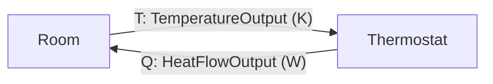

# HeatingLib architecture

HeatingLib simulates a single room heated by a proportional thermostat over one day (86 400 s).
This document describes the code as it is today, checks it against the three project requirements,
and lists what is not yet met.

## Requirements

| # | Requirement | Status (2026-11-21, OpenModelica 1.27.2) |
|---|---|---|
| 1 | Simulate a heated room over a day and show its temperature | **Met, with a caveat.** The simulation runs and produces the room temperature. The room never reaches the 20 °C set point; see [Simulated behaviour](#simulated-behaviour). |
| 2 | Swap the room or the controller for another variant without touching the rest | **Not met.** `System` hard-wires `Room` and `Thermostat`, and the controller depends on a room parameter. See [Gaps](#gaps). |
| 3 | Every model checks in OpenModelica without errors | **Met** for `Room`, `Thermostat` and `System`, and the package loads without errors. |

## Package layout

```
HeatingLib/
  package.mo        package HeatingLib; constant roomHeatCapacity = 5e5 J/K (shared constant)
  package.order     load order: roomHeatCapacity, Interfaces, Room, Thermostat, System
  Interfaces.mo     types and connectors shared by all blocks
  Room.mo           model Room: lumped room air
  Thermostat.mo     block Thermostat: proportional controller
  System.mo         model System: Room + Thermostat, connected, StopTime = 86400 s
tests/
  check.mos         omc script: loads the package and checks HeatingLib.System
```

Note: `package.order` lists `roomHeatCapacity`, which is a constant and not a class. OpenModelica
loads the package without error with this entry present, but the entry does not name a class.

## Components



`System` connects them as `connect(room.T, thermostat.T)` and `connect(thermostat.Q, room.Q_heat)`.
This is a feedback loop: the room temperature drives the heater power, and the heater power drives the
room temperature.

### Interfaces (`Interfaces.mo`)

| Name | Definition | Used for |
|---|---|---|
| `Temperature` | `Real`, quantity ThermodynamicTemperature, unit K, min 0, display °C | All temperatures |
| `HeatFlowRate` | `Real`, quantity Power, unit W | Heater power |
| `TemperatureInput` / `TemperatureOutput` | `input` / `output` of `Temperature` | Room's `T` (output), controller's `T` (input) |
| `HeatFlowInput` / `HeatFlowOutput` | `input` / `output` of `HeatFlowRate` | Room's `Q_heat` (input), controller's `Q` (output) |

The connector causality is the contract between blocks. A component that exposes `TemperatureOutput`
and accepts `HeatFlowInput` can work with the current `System`.

### Room (`Room.mo`)

Lumped air node with one state, `T`:

    C * der(T) = Q_heat - G * (T - T_amb)

| Parameter | Default | Unit | Meaning |
|---|---|---|---|
| `C` | `HeatingLib.roomHeatCapacity` (5e5) | J/K | Heat capacity |
| `G` | 150 | W/K | Wall heat-loss conductance |
| `T_amb` | 273.15 (0 °C) | K | Outdoor temperature |
| `T_start` | 288.15 (15 °C) | K | Initial room temperature |

### Thermostat (`Thermostat.mo`)

Proportional controller, algebraic (no states):

    Q = min(Q_max, max(0, k * (T_set - T)))
    k = HeatingLib.roomHeatCapacity / tau

| Parameter | Default | Unit | Meaning |
|---|---|---|---|
| `T_set` | 293.15 (20 °C) | K | Set point |
| `tau` | 1800 | s | Time to close the gap to the set point |
| `Q_max` | 3000 | W | Heater power limit |
| `k` (protected) | `roomHeatCapacity / tau` ≈ 277.8 | W/K | Controller gain |

### System (`System.mo`)

Instantiates one `Room` and one `Thermostat`, connects them, and sets
`experiment(StopTime = 86400)`.

## Simulated behaviour

Run from a scratch directory (see [Verification](#verification)). Values from the run on
2026-11-21 with default parameters:

| Time | Room temperature | Heater power `Q` |
|---|---|---|
| 0 h | 15.00 °C | 1389 W |
| 1 h | 13.08 °C | 1922 W |
| 2 h | 12.99 °C | 1947 W |
| 24 h | 12.99 °C | 1948 W |

The room settles at about 12.99 °C, about 7 K below the 20 °C set point. This is expected from the
design, not a solver problem. A proportional controller's output is zero when `T = T_set`, but the walls
still lose heat at that temperature. So the equilibrium sits where `k·(T_set − T) = G·(T − T_amb)`:

    T_ss = (k·T_set + G·T_amb) / (k + G) = (277.8·293.15 + 150·273.15) / 427.8 ≈ 286.14 K ≈ 12.99 °C

The solver's final value, 286.137 K, matches this. Reaching 20 °C at steady state would require integral
action, a feed-forward term, or a different controller type.

## Gaps

These block requirement 2. None are fixed in the code yet.

1. **`System` is not replaceable.** `Room room;` and `Thermostat thermostat;` name concrete types.
   Changing either component means editing `System.mo`.
2. **No partial base classes.** Nothing in `Interfaces` defines what a room or a controller must provide,
   so a replacement cannot be checked against a contract.
3. **The controller depends on the room.** `Thermostat.k` reads `HeatingLib.roomHeatCapacity` directly.
   A room variant with a different `C` would silently get the wrong gain.

Planned direction, not yet implemented: add partial `PartialRoom` and `PartialController` classes in
`Interfaces` with the same connectors. Declare `replaceable Room room constrainedby PartialRoom` and
`replaceable Thermostat thermostat constrainedby PartialController` in `System`. Give the controller its own
parameter for the plant's heat capacity, or a gain parameter, instead of the package constant.

## Verification

Requires OpenModelica (`omc`). Tested with 1.27.2.

Check the library, as in the README:

```sh
omc tests/check.mos
```

This checks `HeatingLib.System`, which instantiates `Room` and `Thermostat`, so both are compiled.
It does not call `checkModel` on `Room` or `Thermostat` alone. Those were checked separately on
2026-11-21 with no errors.

Simulate the day. The simulation writes many intermediate files into the current directory, so run it
from a scratch directory, not the project root. Use an absolute path to the package:

```modelica
loadFile("/abs/path/to/HeatingLib/package.mo");
simulate(HeatingLib.System, stopTime=86400, numberOfIntervals=24, outputFormat="csv", fileNamePrefix="sys");
```

The output is `sys_res.csv` with columns `room.T`, `der(room.T)`, `thermostat.Q`, `room.Q_heat`, `thermostat.T`.
Temperatures are in K.
