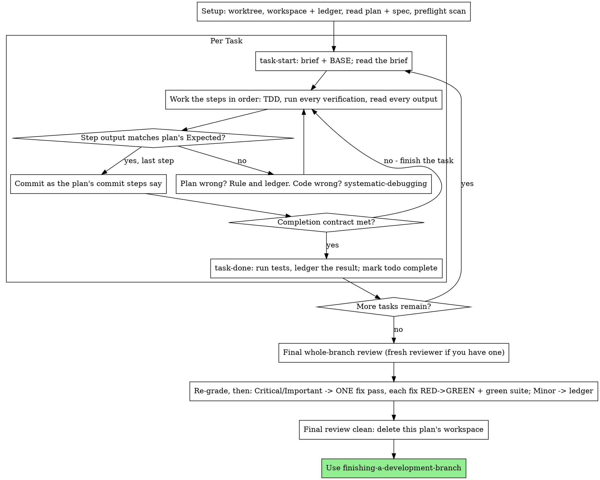

### user

/sa:executing-plans Execute the plan in docs/plans/2026-11-22-search-and-tags.md, inline, in this session. Work in
this checkout, on its current branch, and commit as you go. I'm the project's architect and I'm
here: ask me if you need me.

### assistant

I'll start by reading the plan and setting up the workspace.

### tool_use Bash

```json
{
 "command": "git status --short && git branch --show-current && ls -la docs/plans/ && cat docs/plans/2026-11-22-search-and-tags.md && ls docs/architecture 2>/dev/null; ls /tmp/sa-arm-4p0npeqt/sa/skills/executing-plans/scripts/",
 "description": "Check git state, read plan, list skill scripts"
}
```

### tool_result

```
master
total 12
drwxr-xr-x 2 root root 4096 Nov 22 10:15 .
drwxr-xr-x 5 root root 4096 Nov 22 10:15 ..
-rw-r--r-- 1 root root 1335 Nov 22 10:17 2026-11-22-search-and-tags.md
# Search and tags Implementation Plan

**Goal:** Search shows the newest notes first, and notes can carry tags that `list` filters on.

**Tech Stack:** Python 3.11 standard library; `unittest`.

## Global Constraints

- Run `python3 -m unittest` after every task; it passes.
- One commit per task.

### Task 1: Newest search results first

**Files:** Modify `notes/store.py`, `tests/test_notes.py`.

- [ ] **Step 1:** Test `test_search_lists_newest_first`: add "Buy milk", then "Milk the budget", search "milk", expect "Milk the budget" before "Buy milk". Run it. Expected: fails.
- [ ] **Step 2:** In `Store.search`, order by id, newest first. Expected: all tests pass. **Commit** `feat: list search results newest first`.

### Task 2: Tags

**Files:** Modify `notes/store.py`, `notes/cli.py`, `notes/model.py`, `tests/test_notes.py`.

- [ ] **Step 1:** Tests: `notes add --tag work "Call Ann"` stores the tag; `notes list --tag work` prints only notes tagged `work`; a store created before this change still opens. Expected: fail.
- [ ] **Step 2:** Add a `tags` column (comma-separated text, default empty) to the `notes` table, migrating an existing table with `ALTER TABLE`; `Note` gains `tags`; `add` takes `--tag` (repeatable); `list` takes `--tag`. Expected: all tests pass. **Commit** `feat: tag notes and filter list by tag`.
arc42.md
review-package
sdd-workspace
task-brief
task-done
task-start
```

### assistant

The plan is committed, and the working tree is clean on `master`. You asked me to work on the current branch, so I'll treat that as your consent to commit on `master` rather than create a worktree. Next I'll set up the workspace and read the inline reference.

### tool_use Bash

```json
{
 "command": "S=/tmp/sa-arm-4p0npeqt/sa/skills/executing-plans && bash $S/scripts/sdd-workspace docs/plans/2026-11-22-search-and-tags.md; echo \"---\"; cat $S/references/inline.md; echo \"---ARCH\"; cat $S/references/architecture-decisions.md; echo \"---PRE\"; cat $S/references/preflight.md",
 "description": "Run workspace script and read inline references"
}
```

### tool_result

```
/tmp/sa-eval-pzxuybp1/project/.skills/sdd/2026-11-22-search-and-tags
---
# Inline Execution

Mode 1. You implement every task yourself in this session. One fresh review of the whole branch at the end. No implementer subagent per task, no reviewer per task.

**What it buys and costs.** Subagent-driven development pays for a fresh implementer and a fresh reviewer on every task, each re-reading the codebase from zero. Inline pays for one context (yours) plus one reviewer at the end. What it gives up is a fresh context per task and a second pair of eyes per task. This mode keeps what those two things bought, by other means: the brief is the spec, the ledger is your memory, TDD is the per-task gate, and the final reviewer is the second pair of eyes.

**Narration:** between tool calls, narrate at most one short line — the ledger and the tool results carry the record.

A fully specified plan makes inline execution transcription plus testing: it runs well on a mid-tier session model. The one place the most capable model earns its cost is the final review, which you dispatch separately.



## Setup
[... 11952 chars cut]
```

### tool_use Bash

```json
{
 "command": "find . -path ./.git -prune -o -type f -print | head -100 && echo --- && cat docs/architecture/arc42.md | head -150",
 "description": "List project files and read architecture doc"
}
```

### tool_result

```
./README.md
./GLOSSARY.md
./notes/__main__.py
./notes/cli.py
./notes/store.py
./notes/__init__.py
./notes/model.py
./tests/test_notes.py
./tests/__init__.py
./.skills/sdd/.gitignore
./docs/adr/0002-record-architecture-decisions.md
./docs/adr/0003-cli-reaches-storage-only-through-store.md
./docs/adr/0001-use-sqlite-for-storage.md
./docs/plans/2026-11-22-search-and-tags.md
./docs/architecture/arc42.md
./.skills/sdd/2026-11-22-search-and-tags/plan-path
---
# notes: architecture

Structured after the arc42 template (https://arc42.org). Empty sections are filled when needed.

## 1. Introduction and goals

### Requirements overview

| ID | requirement | rank | status | reason |
|---|---|---|---|---|
| R-1 | Users add, list and search notes from the command line. | 1 | active | core use |
| R-2 | No note is lost when the process or machine crashes. | 2 | active | users keep notes for years |
| R-3 | Runs on Linux and macOS with only the Python standard library. | 3 | active | installed on locked-down machines |
| R-4 | Notes sync between a user's devices. | - | deferred | needs a server; revisit next year |
| R-5 | A graphical user interface. | - | rejected | the CLI audience does not want one |

### Quality goals

| ID | goal (ISO/IEC 25010) | from | scenario |
|---|---|---|---|
| QG-1 | Reliability: fault tolerance | R-2 | QS-1 |
| QG-2 | Portability: installability | R-3 | QS-2 |
| QG-3 | Maintainability: modifiability | R-1 | QS-3 |

### Stakeholders

| role | expectation |
|---|---|
| Architect (project owner) | decides the architecture; accepts ADRs |
| Users | keep notes for years without losing any |
| Contributors | change one part without learning the whole program |

## 2. Constraints

- Python 3.11 or later, standard library only (R-3).

## 3. Context and scope

## 4. Solution strategy

## 5. Building block view

| block | responsibility | may use |
|---|---|---|
| `cli` | parse commands, print results and errors | `store`, `model` |
| `store` | keep notes between runs; the only block that knows the storage | `model` |
| `model` | the `Note` value | - |

## 6. Runtime view

## 7. Deployment view

## 8. Crosscutting concepts

- Errors: reported on stderr as `notes: <message>`, exit code 1.

## 9. Architecture decisions

Decisions are recorded as ADRs in [docs/adr/](../adr/). What is decided centrally is listed in
[ADR-0002 Record architecture decisions](../adr/0002-record-architecture-decisions.md).

## 10. Quality requirements

| ID | goal | stimulus | environment | response | measure |
|---|---|---|---|---|---|
| QS-1 | QG-1 | the process is killed with SIGKILL during `add` | normal operation | the note is either fully stored or absent; the store still opens | 0 unreadable stores in 100 trials |
| QS-2 | QG-2 | a user runs `python3 -m notes list` | fresh Linux or macOS with Python 3.11+ | it works without installing anything | 0 install steps |
| QS-3 | QG-3 | a contributor swaps the storage engine | development | only `notes/store.py` and its tests change | 0 other files changed |

## 11. Risks and technical debt

## 12. Glossary

See [GLOSSARY.md](../../GLOSSARY.md).
```

### assistant

No prior ledger exists, so this is a fresh run. Next I'll read the ADRs, the code, and the tests.

### tool_use Bash

```json
{
 "command": "for f in docs/adr/*.md; do echo \"=== $f\"; cat \"$f\"; done; echo \"=== GLOSSARY\"; cat GLOSSARY.md; echo \"=== README\"; cat README.md",
 "description": "Read ADRs, glossary, README"
}
```

### tool_result

```
=== docs/adr/0001-use-sqlite-for-storage.md
# 1. Use SQLite for storage

## Status

accepted 2026-10-01

## Context

Notes must survive crashes (R-2, QG-1, QS-1) and the program may use only the Python standard
library (R-3, QG-2). The standard library ships `sqlite3`, whose transactions are atomic.

## Decision

Store all notes in one SQLite database file, by default `~/.notes.db`.

## Consequences

Crash safety comes from SQLite transactions. The file is binary, so it cannot be read or
repaired with a text editor.
=== docs/adr/0002-record-architecture-decisions.md
# 2. Record architecture decisions

## Status

accepted 2026-10-01

## Context

The architect decides the architecture; contributors and agents implement it. We need a line
between decisions the architect makes centrally and decisions left to whoever builds a block
(R-1, QG-3).

## Decision

We record architecture decisions as ADRs in `docs/adr/`, in Nygard form.

Decided centrally (needs an ADR the architect accepts):

- the storage engine and the on-disk format;
- the dependency rule between blocks: `cli` → `store` → `model`;
- import and export formats;
- CLI command names and exit codes;
- third-party dependencies.

Left to the building blocks (no ADR): internal helpers, SQL query structure, test layout.

## Consequences

Work that depends on a decision on the list waits until its ADR is accepted.
=== docs/adr/0003-cli-reaches-storage-only-through-store.md
# 3. CLI reaches storage only through the store module

## Status

accepted 2026-10-01

## Context

Contributors should be able to swap the storage engine by changing one module (QG-3, QS-3).

## Decision

Only `notes/store.py` imports `sqlite3` or touches the database file. `notes/cli.py` uses the
`Store` class and the `Note` value.

## Consequences

Any new command that reads or writes notes goes through `Store`.
=== GLOSSARY
# Glossary

**Note**: a short piece of text a user keeps, with an id and the time it was created.

**Store**: the place notes are kept between runs.
=== README
# notes

Keep short notes from the command line.

```sh
python3 -m notes add "Buy milk"
python3 -m notes list
python3 -m notes search milk
```

Notes are stored in `~/.notes.db` (set `NOTES_DB` to use another file). Run the tests with
`python3 -m unittest`. Architecture: [docs/architecture/arc42.md](docs/architecture/arc42.md).
```

### tool_use Bash

```json
{
 "command": "for f in notes/*.py tests/test_notes.py; do echo \"=== $f\"; cat -n \"$f\"; done; echo; git log --oneline | head; cat .skills/sdd/2026-11-22-search-and-tags/plan-path; ls -la .skills/sdd/2026-11-22-search-and-tags/",
 "description": "Read source and test files"
}
```

### tool_result

```
=== notes/__init__.py
     1	"""Keep short notes from the command line."""
=== notes/__main__.py
     1	import sys
     2	
     3	from notes.cli import main
     4	
     5	sys.exit(main())
=== notes/cli.py
     1	import argparse
     2	import sys
     3	
     4	from notes.store import Store, default_path
     5	
     6	
     7	def main(argv=None):
     8	    parser = argparse.ArgumentParser(prog="notes", description="Keep short notes.")
     9	    sub = parser.add_subparsers(dest="command", required=True)
    10	    sub.add_parser("add", help="add a note").add_argument("text")
    11	    sub.add_parser("list", help="list all notes")
    12	    sub.add_parser("search", help="find notes containing a term").add_argument("term")
    13	    args = parser.parse_args(argv)
    14	    try:
    15	        store = Store(default_path())
    16	    except Exception as e:  # arc42 section 8: errors go to stderr, exit code 1
    17	        print(f"notes: {e}", file=sys.stderr)
    18	        return 1
    19	    try:
    20	        if args.command == "add":
    21	            note = store.add(args.text)
    22	            print(note.id)
    23	        else:
    24	            found = store.all() if args.command == "list" else store.search(args.term)
    25	            for note in found:
    26	                print(f"{note.id}\t{note.created}\t{note.text}")
    27	    finally:
    28	        store.close()
    29	    return 0
=== notes/model.py
     1	from dataclasses import dataclass
     2	
     3	
     4	@dataclass(frozen=True)
     5	class Note:
     6	    id: int
     7	    text: str
     8	    created: str
=== notes/store.py
     1	"""The only module that knows how notes are stored (ADR-0001, ADR-0003)."""
     2	import os
     3	import sqlite3
     4	from datetime import datetime, timezone
     5	from pathlib import Path
     6	
     7	from notes.model import Note
     8	
     9	
    10	def default_path():
    11	    return Path(os.environ.get("NOTES_DB", Path.home() / ".notes.db"))
    12	
    13	
    14	class Store:
    15	    def __init__(self, path):
    16	        self._db = sqlite3.connect(path)
    17	        self._db.execute("CREATE TABLE IF NOT EXISTS notes "
    18	                         "(id INTEGER PRIMARY KEY, text TEXT NOT NULL, created TEXT NOT NULL)")
    19	
    20	    def add(self, text):
    21	        created = datetime.now(timezone.utc).isoformat(timespec="seconds")
    22	        with self._db:
    23	            cur = self._db.execute("INSERT INTO notes (text, created) VALUES (?, ?)",
    24	                                   (text, created))
    25	        return Note(cur.lastrowid, text, created)
    26	
    27	    def all(self):
    28	        rows = self._db.execute("SELECT id, text, created FROM notes ORDER BY id")
    29	        return [Note(*row) for row in rows]
    30	
    31	    def search(self, term):
    32	        rows = self._db.execute("SELECT id, text, created FROM notes WHERE text LIKE ? ORDER BY id",
    33	                                (f"%{term}%",))
    34	        return [Note(*row) for row in rows]
    35	
    36	    def close(self):
    37	        self._db.close()
=== tests/test_notes.py
     1	import io
     2	import os
     3	import tempfile
     4	import unittest
     5	from contextlib import redirect_stdout
     6	from pathlib import Path
     7	from unittest import mock
     8	
     9	from notes.cli import main
    10	from notes.store import Store
    11	
    12	
    13	class StoreTest(unittest.TestCase):
    14	    def setUp(self):
    15	        self.store = Store(Path(tempfile.mkdtemp()) / "n.db")
    16	
    17	    def tearDown(self):
    18	        self.store.close()
    19	
    20	    def test_add_then_list(self):
    21	        self.store.add("Buy milk")
    22	        self.assertEqual([n.text for n in self.store.all()], ["Buy milk"])
    23	
    24	    def test_search_matches_substring(self):
    25	        self.store.add("Buy milk")
    26	        self.store.add("Call Ann"
[... 935 chars cut]
```

### assistant

The plan's Task 2 changes the on-disk schema (a new `tags` column). ADR-0002 lists the storage format as a centrally decided item, and no accepted ADR covers tags, so that part needs your decision. Task 1 touches only search ordering, so it is independent. I'll load the TDD discipline and read the helper scripts before starting.

### tool_use Skill

```json
{
 "skill": "sa:test-driven-development"
}
```

### tool_result

```
Launching skill: sa:test-driven-development
```

### tool_use Bash

```json
{
 "command": "S=/tmp/sa-arm-4p0npeqt/sa/skills/executing-plans; cat $S/scripts/task-start; echo ====; cat $S/scripts/task-done; echo ====; cat $S/scripts/sdd-workspace; echo ====; cat /tmp/sa-eval-pzxuybp1/project/.skills/sdd/.gitignore; cd /tmp/sa-eval-pzxuybp1/project && python3 --version && python3 -m unittest 2>&1 | tail -5",
 "description": "Read helper scripts and run baseline tests"
}
```

### tool_result

```
#!/usr/bin/env bash
# Begin one task of an inline plan execution in a single call: extract the
# task's brief (via this skill's task-brief, so both execution modes share one
# workspace) and record BASE, the commit the task's review range is cut from.
# One tool call instead of two, because every call in an inline session is a
# turn that re-reads the whole context.
#
# Usage: task-start PLAN_FILE TASK_NUMBER
# Prints:
#   brief: <path to the task's brief file>
#   base:  <full SHA of HEAD>
set -euo pipefail

if [ $# -ne 2 ]; then
  echo "usage: task-start PLAN_FILE TASK_NUMBER" >&2
  exit 2
fi

plan=$1
n=$2
here=$(cd "$(dirname "$0")" && pwd)

out=$("${BASH:-bash}" "$here/task-brief" "$plan" "$n")
brief=$(printf '%s\n' "$out" | sed -n 's/^wrote \(.*\): [0-9][0-9]* lines$/\1/p')
[ -n "$brief" ] || { echo "task-brief did not report a path: $out" >&2; exit 1; }

echo "brief: $brief"
echo "base: $(git rev-parse HEAD)"
====
#!/usr/bin/env bash
# Close one task of an inline plan execution in a single call: run the task's
# test command, keep its full output in the workspace, print the tail, and —
# only if the command succeeded — append the completion line to the ledger.
# A failing command records nothing: the task is not complete.
#
# Usage: task-done PLAN_FILE TASK_NUMBER BASE -- TEST_COMMAND [ARGS...]
#   BASE is the SHA task-start printed; the completion line records BASE..HEAD.
# Exit: the test command's exit status.
set -euo pipefail

if [ $# -lt 5 ] || [ "$4" != "--" ]; then
  echo "usage: task-done PLAN_FILE TASK_NUMBER BASE -- TEST_COMMAND [ARGS...]" >&2
  exit 2
fi

plan=$1
n=$2
base=$3
shift 4
here=$(cd "$(dirname "$0")" && pwd)

git rev-parse --verify --quiet "$base" >/dev/null || { echo "bad BASE: $base" >&2; exit 2; }

dir=$("${BASH:-bash}" "$here/sdd-workspace" "$plan")
log="$dir/task-${n}-tests.log"
ledger="$dir/progress.md"

# Render the command the way a person would type it, for the ledger line.
cmd=""
for a in "$@"; do
  case "$a" in
    *[[:space:]\"\;\|\&]*) cmd="$cmd '$a'" ;;
    *) cmd="$cmd $a" ;;
  esac
done
cmd=${cmd# }

rc=0
"$@" > "$log" 2>&1 || rc=$?

tail -n 5 "$log"
if [ "$rc" -ne 0 ]; then
  echo "task-done: test command exited $rc; Task $n NOT recorded (full output: $log)" >&2
  exit "$rc"
fi

last=$(grep -v '^[[:space:]]*$' "$log" | tail -n 1) || last="(no output)"
[ -f "$ledger" ] || printf '# SDD ledger — plan: %s\n' "$plan" > "$ledger"
line="Task $n: complete (commits $(git rev-parse --short=7 "$base")..$(git rev-parse --short=7 HEAD), tests: $cmd → $last)"
printf '%s\n' "$line" >> "$ledger"
echo "ledger: $line"
====
#!/usr/bin/env bash
# Resolve and ensure the working-tree directory this skill uses for one
# plan's short-lived artifacts: task briefs, implementer reports, review
# packages, and the progress ledger. Print the plan directory's absolute path.
#
# One directory per plan (.skills/sdd/<plan-basename>/) so a follow-up
# plan in the same working tree can never read or overwrite another plan's
# artifacts. A stale ledger misread as current progress makes controllers
# skip whole task sequences — plan-scoping removes that failure structurally.
#
# Basename slugs collide when two plans share a filename (docs/alpha/plan.md
# vs docs/beta/plan.md), so each workspace records its owning plan's path in
# a plan-path marker (repo-relative in-repo, absolute outside). A workspace
# owned by a different plan is skipped and the slug disambiguated with the
# plan's parent-directory name, then a counter. A workspace with no marker
# predates the marker scheme and is adopted for the current plan so in-flight
# workspaces keep resolving — which means the first collision on such a
# legacy workspace adopts instead of detecting; acceptable, marker-less
# workspaces age out as plans finish.
#
# The workspace lives in the working tree (not under .git/) because harnesses
# treat .git/ as a protected path and deny agent writes there — which blocks
# an implementer subagent from writing its report file. A se
[... 2383 chars cut]
```

### assistant

TDD is loaded. The seams are already in the suite: `Store` and `cli.main`, which the existing tests use. I'll use those and say so in the final message. Next: the preflight ledger, then Task 1's failing test.

### tool_use Bash

```json
{
 "command": "S=/tmp/sa-arm-4p0npeqt/sa/skills/executing-plans && W=.skills/sdd/2026-11-22-search-and-tags && cat > $W/progress.md <<'EOF'\n# SDD ledger — plan: docs/plans/2026-11-22-search-and-tags.md\n\nPre-flight:\n- Task 1 vs Task 2 — share `notes/store.py` (`search`, `all`) and `tests/test_notes.py`. Task 2 changes the SELECT column list of `all`/`search` (adds `tags`), so it must follow Task 1's `search` change. Ruling: Task 2 keeps Task 1's ORDER BY id DESC in `search`. — cost if wrong: merge conflict in `search`.\n- Task 2 vs ADR-0002 — Task 2 changes the on-disk schema (new `tags` column). ADR-0002 centrally decides \"the storage engine and the on-disk format\"; no accepted ADR covers tags. Paused: Task 2 — waits for ADR-0004 (accept the `tags` column design: comma-separated TEXT, migrated with ALTER TABLE).\n- Task 1 self-check: plan text agrees (test names search, code orders search). OK.\n- Task 2 self-check: plan text agrees (tests named, columns named). `add --tag` and `list --tag` are CLI options, not command names — ADR-0002 central list untouched.\n- Seams: `Store` (tests/test_notes.py StoreTest) and `notes.cli.main` (CliTest), as existing tests already use.\nEOF\nbash $S/scripts/task-start docs/plans/2026-11-22-search-and-tags.md 1",
 "description": "Write preflight ledger and start Task 1"
}
```

### tool_result

```
brief: /tmp/sa-eval-pzxuybp1/project/.skills/sdd/2026-11-22-search-and-tags/task-1-brief.md
base: 3f89b5eac3ec0fdc0250cd4f9dff171dfb680464
```

### assistant

Task 1 base is `3f89b5e`. Now the failing test, which I'll run before changing any production code.

### tool_use Edit

```json
{
 "replace_all": false,
 "file_path": "/tmp/sa-eval-pzxuybp1/project/tests/test_notes.py",
 "old_string": "        self.assertEqual([n.text for n in self.store.search(\"mil\")], [\"Buy milk\"])\n",
 "new_string": "        self.assertEqual([n.text for n in self.store.search(\"mil\")], [\"Buy milk\"])\n\n    def test_search_lists_newest_first(self):\n        self.store.add(\"Buy milk\")\n        self.store.add(\"Milk the budget\")\n        self.assertEqual([n.text for n in self.store.search(\"milk\")],\n                         [\"Milk the budget\", \"Buy milk\"])\n"
}
```

### tool_result

```
The file /tmp/sa-eval-pzxuybp1/project/tests/test_notes.py has been updated successfully.
```

### tool_use Bash

```json
{
 "command": "python3 -m unittest 2>&1 | tail -15",
 "description": "Run tests to verify the new test fails"
}
```

### tool_result

```
                     ["Milk the budget", "Buy milk"])
                     ^^^^^^^^^^^^^^^^^^^^^^^^^^^^^^^^
AssertionError: Lists differ: ['Buy milk', 'Milk the budget'] != ['Milk the budget', 'Buy milk']

First differing element 0:
'Buy milk'
'Milk the budget'

- ['Buy milk', 'Milk the budget']
+ ['Milk the budget', 'Buy milk']

----------------------------------------------------------------------
Ran 4 tests in 0.096s

FAILED (failures=1)
```

### assistant

RED confirmed: the test fails on the expected assertion, with oldest-first order. Now the minimal change to `search`.

### tool_use Edit

```json
{
 "replace_all": false,
 "file_path": "/tmp/sa-eval-pzxuybp1/project/notes/store.py",
 "old_string": "WHERE text LIKE ? ORDER BY id\",",
 "new_string": "WHERE text LIKE ? ORDER BY id DESC\","
}
```

### tool_result

```
The file /tmp/sa-eval-pzxuybp1/project/notes/store.py has been updated successfully.
```

### tool_use Bash

```json
{
 "command": "python3 -m unittest 2>&1 | tail -3",
 "description": "Run full test suite after the change"
}
```

### tool_result

```
Ran 4 tests in 0.096s

OK
```

### assistant

Green on the full suite. I'll commit the change, then record the task with `task-done`, which runs the tests again and writes the ledger line.

### tool_use Bash

```json
{
 "command": "git add notes/store.py tests/test_notes.py && git commit -q -m \"feat: list search results newest first\" && S=/tmp/sa-arm-4p0npeqt/sa/skills/executing-plans && bash $S/scripts/task-done docs/plans/2026-11-22-search-and-tags.md 1 3f89b5eac3ec0fdc0250cd4f9dff171dfb680464 -- python3 -m unittest && git status --short && git log --oneline | head -3",
 "description": "Commit Task 1 and record completion in ledger"
}
```

### tool_result

```
....
----------------------------------------------------------------------
Ran 4 tests in 0.101s

OK
ledger: Task 1: complete (commits 3f89b5e..ce59ee9, tests: python3 -m unittest → OK)
?? notes/__pycache__/
?? tests/__pycache__/
ce59ee9 feat: list search results newest first
3f89b5e fixture
```

### assistant

Task 1 is done: committed as `ce59ee9`, and the ledger records it. The `__pycache__` directories are untracked by-products of running the tests, and I'm leaving them out of the commit. Task 2 changes the on-disk schema, which ADR-0002 reserves for the architect. Per the architecture-decisions reference, I'll draft a proposed ADR for it, load the domain-modeling skill for the format.

### tool_use Skill

```json
{
 "skill": "sa:domain-modeling"
}
```

### tool_result

```
Launching skill: sa:domain-modeling
```

### tool_use Bash

```json
{
 "command": "cat /tmp/sa-arm-4p0npeqt/sa/skills/domain-modeling/ADR-FORMAT.md; echo ===; git log --format='%h %ad %s' --date=short -- docs/adr | head",
 "description": "Read ADR format and ADR history"
}
```

### tool_result

```
# ADR Format

ADRs live in the project's ADR directory as `NNNN-slug.md`, numbered one above the highest
existing number. That directory is the one where the project already keeps its ADRs (such as
`docs/decisions/`), or `docs/adr/`, created when the first ADR is needed. ADRs stay where they
are; a new ADR goes beside them. When and with which status to write one:
[SKILL.md](./SKILL.md#architectural-decisions).

## Template

Nygard's five fields, all required:

```md
# {N}. {Short title of the decision}

## Status

{proposed | accepted YYYY-MM-DD | rejected YYYY-MM-DD: reason | superseded by ADR-NNNN}

## Context

{The forces at play: the requirements and quality goals the decision serves, cited by ID
(R-n, QG-n, QS-n) where the project has them, otherwise named in words; constraints; the ADR
this one replaces, if any.}

## Decision

{What we will do, in active voice: "We will …".}

## Consequences

{What becomes easier and harder, including effects on other ADRs and the work that follows.}
```

The Status field's first line is the status. Keep every ADR short: a few sentences per field.

## What qualifies

Examples of decisions that meet the rule in SKILL.md:

- **Architectural shape.** "The write model is event-sourced, the read model is projected into Postgres."
- **Integration between contexts.** "Ordering and Billing communicate via domain events, not synchronous HTTP."
- **Technology with lock-in.** Database, message bus, auth provider, deployment target; not every library.
- **Boundaries and formats.** "Customer data is owned by the Customer context; others reference it by ID." Import and export formats, file layouts, wire formats.
- **Deliberate deviations from the obvious path.** "Manual SQL instead of an ORM because X."
- **Constraints not visible in the code.** "No AWS, for compliance." "Responses under 200 ms, per the partner contract."
===
3f89b5e 2026-11-22 fixture
```

### assistant

No ADR is accepted for tags yet, so the next number is 0004. I'll write it as `proposed`, with the recommendation marked for you to approve.

### tool_use Write

```json
{
 "file_path": "/tmp/sa-eval-pzxuybp1/project/docs/adr/0004-store-tags-as-comma-separated-column.md",
 "content": "# 4. Store note tags as a comma-separated column on notes\n\n## Status\n\nproposed\n\n## Context\n\nUsers want to group notes with tags and list one group with `notes list --tag` (R-1, QG-3).\nThe store is one SQLite table (ADR-0001), and the on-disk format is decided centrally\n(ADR-0002). Existing stores must keep opening, since users keep notes for years (QG-1, QS-1).\nTags must stay within the standard library (R-3). The plan this comes from lists the options\nas a comma-separated TEXT column; a separate `tags` table was not evaluated by the plan.\n\n## Decision\n\nRecommended, awaiting the architect.\n\nWe will add a `tags` column to the `notes` table: TEXT, NOT NULL, default empty, holding the\nnote's tags comma-separated. An existing table is migrated with `ALTER TABLE` when the store\nopens. Only `notes/store.py` touches the column (ADR-0003).\n\n## Consequences\n\n- The on-disk format changes. Stores written before this change still open; their notes have\n  no tags. This is the change ADR-0002 reserves for the architect.\n- A tag cannot contain a comma. The CLI must reject such a tag, or the filter misreads it.\n- Filtering by tag matches whole tags, not substrings of the stored text, so the store has\n  to compare each tag on its own.\n- A separate `tags` table would support tag listing and renaming without parsing text. It is\n  the alternative if tag management grows beyond filtering; choosing it later means another\n  format change and a new ADR.\n- Affects no other accepted ADR. ADR-0003 is respected: `cli` still reaches storage only\n  through `Store`.\n"
}
```

### tool_result

```
File created successfully at: /tmp/sa-eval-pzxuybp1/project/docs/adr/0004-store-tags-as-comma-separated-column.md (file state is current in your context — no need to Read it back)
```

### tool_use Bash

```json
{
 "command": "git add docs/adr/0004-store-tags-as-comma-separated-column.md && git commit -q -m \"docs(adr): propose storing note tags as a comma-separated column\" && printf 'Paused: Task 2 — waits for ADR-0004 (architect: accept or reject the comma-separated tags column, or name the alternative: a separate tags table)\\n' >> .skills/sdd/2026-11-22-search-and-tags/progress.md && git log --oneline | head -3 && git status --short && cat .skills/sdd/2026-11-22-search-and-tags/progress.md",
 "description": "Commit proposed ADR alone and ledger the pause"
}
```

### tool_result

```
b484aef docs(adr): propose storing note tags as a comma-separated column
ce59ee9 feat: list search results newest first
3f89b5e fixture
?? notes/__pycache__/
?? tests/__pycache__/
# SDD ledger — plan: docs/plans/2026-11-22-search-and-tags.md

Pre-flight:
- Task 1 vs Task 2 — share `notes/store.py` (`search`, `all`) and `tests/test_notes.py`. Task 2 changes the SELECT column list of `all`/`search` (adds `tags`), so it must follow Task 1's `search` change. Ruling: Task 2 keeps Task 1's ORDER BY id DESC in `search`. — cost if wrong: merge conflict in `search`.
- Task 2 vs ADR-0002 — Task 2 changes the on-disk schema (new `tags` column). ADR-0002 centrally decides "the storage engine and the on-disk format"; no accepted ADR covers tags. Paused: Task 2 — waits for ADR-0004 (accept the `tags` column design: comma-separated TEXT, migrated with ALTER TABLE).
- Task 1 self-check: plan text agrees (test names search, code orders search). OK.
- Task 2 self-check: plan text agrees (tests named, columns named). `add --tag` and `list --tag` are CLI options, not command names — ADR-0002 central list untouched.
- Seams: `Store` (tests/test_notes.py StoreTest) and `notes.cli.main` (CliTest), as existing tests already use.
Task 1: complete (commits 3f89b5e..ce59ee9, tests: python3 -m unittest → OK)
Paused: Task 2 — waits for ADR-0004 (architect: accept or reject the comma-separated tags column, or name the alternative: a separate tags table)
```

### assistant

Task 1 is done and committed. Task 2 is paused until you decide on a storage design, so the plan is not finished. The final review and cleanup wait for it.

**Question for you:** Task 2 adds a `tags` column to the `notes` table. That changes the on-disk format, which ADR-0002 reserves for you, and no accepted ADR covers it. I drafted **ADR-0004** (`docs/adr/0004-store-tags-as-comma-separated-column.md`, status `proposed`, committed alone as `b484aef`). It follows the plan: a comma-separated TEXT column, migrated with `ALTER TABLE`. Please accept or reject it. If you'd rather have a separate `tags` table, tell me and I'll redraft the ADR and Task 2 to match.

**Done**
- **Task 1, newest search results first:** commit `ce59ee9` (`feat: list search results newest first`). I saw the new test fail with oldest-first order, then made the one-line change (`ORDER BY id DESC`). The suite passes: 4 tests, OK. The ledger records it at `.skills/sdd/2026-11-22-search-and-tags/progress.md`.

**Not done**
- **Task 2, tags:** paused. I have not written any tag code.

**Rulings I made**
- Task 2 keeps Task 1's `ORDER BY id DESC` in `search`. Cost if wrong: a merge conflict in `search`.

**Deferred minors**
- None.

**Choices I took**
- **Seams:** the tests run at the existing seams, `Store` and `notes.cli.main`, which the suite already uses. Say if you want different ones.
- **Branch:** I committed directly on `master`, because you asked me to work on the current branch.
- **Untracked files:** `notes/__pycache__/` and `tests/__pycache__/` are left uncommitted.

When you answer on ADR-0004, I'll run Task 2 with TDD, then the final review and cleanup.

### result (success)
