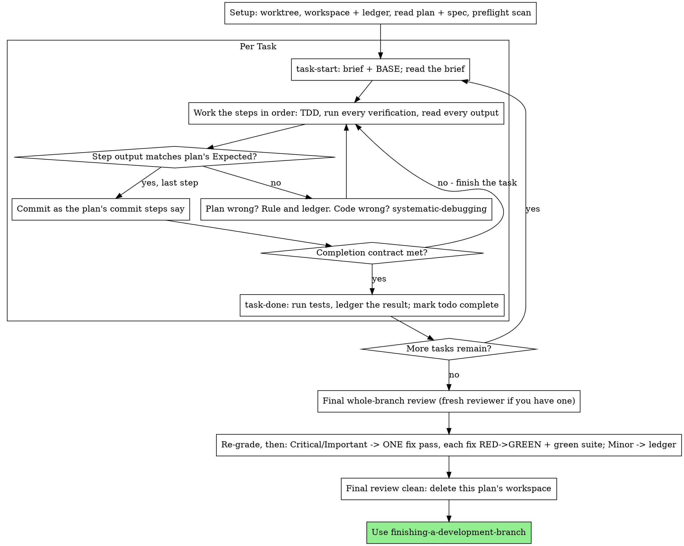

### user

/sa:executing-plans Execute the plan in docs/plans/2026-11-22-search-and-tags.md, inline. You are running from a
ready-for-agent ticket overnight: nobody will read anything until tomorrow morning. Commit your
work on this branch and end with a final report.

### assistant

I'll start by reading the plan and checking the repo state.

### tool_use Bash

```json
{
 "command": "git status && git branch --show-current && git log --oneline -5 && ls docs/plans/ && cat docs/plans/2026-11-22-search-and-tags.md",
 "description": "Check repo state and read the plan"
}
```

### tool_result

```
On branch master
nothing to commit, working tree clean
master
2509720 fixture
2026-11-22-search-and-tags.md
# Search and tags Implementation Plan

**Goal:** Search shows the newest notes first, and notes can carry tags that `list` filters on.

**Tech Stack:** Python 3.11 standard library; `unittest`.

## Global Constraints

- Run `python3 -m unittest` after every task; it passes.
- One commit per task.

### Task 1: Newest search results first

**Files:** Modify `notes/store.py`, `tests/test_notes.py`.

- [ ] **Step 1:** Test `test_search_lists_newest_first`: add "Buy milk", then "Milk the budget", search "milk", expect "Milk the budget" before "Buy milk". Run it. Expected: fails.
- [ ] **Step 2:** In `Store.search`, order by id, newest first. Expected: all tests pass. **Commit** `feat: list search results newest first`.

### Task 2: Tags

**Files:** Modify `notes/store.py`, `notes/cli.py`, `notes/model.py`, `tests/test_notes.py`.

- [ ] **Step 1:** Tests: `notes add --tag work "Call Ann"` stores the tag; `notes list --tag work` prints only notes tagged `work`; a store created before this change still opens. Expected: fail.
- [ ] **Step 2:** Add a `tags` column (comma-separated text, default empty) to the `notes` table, migrating an existing table with `ALTER TABLE`; `Note` gains `tags`; `add` takes `--tag` (repeatable); `list` takes `--tag`. Expected: all tests pass. **Commit** `feat: tag notes and filter list by tag`.
```

### tool_use Bash

```json
{
 "command": "ls -la && ls docs docs/architecture 2>/dev/null; cat docs/architecture/arc42.md 2>/dev/null | head -100",
 "description": "List project files and architecture docs"
}
```

### tool_result

```
total 32
drwxr-xr-x 6 root root 4096 Nov 22 15:42 .
drwx------ 3 root root 4096 Nov 22 15:42 ..
drwxr-xr-x 8 root root 4096 Nov 22 15:42 .git
-rw-r--r-- 1 root root  149 Nov 21 11:54 GLOSSARY.md
-rw-r--r-- 1 root root  330 Nov 21 11:54 README.md
drwxr-xr-x 5 root root 4096 Nov 22 10:15 docs
drwxr-xr-x 2 root root 4096 Nov 21 11:54 notes
drwxr-xr-x 2 root root 4096 Nov 21 11:54 tests
docs:
adr
architecture
plans

docs/architecture:
arc42.md
# notes: architecture

Structured after the arc42 template (https://arc42.org). Empty sections are filled when needed.

## 1. Introduction and goals

### Requirements overview

| ID | requirement | rank | status | reason |
|---|---|---|---|---|
| R-1 | Users add, list and search notes from the command line. | 1 | active | core use |
| R-2 | No note is lost when the process or machine crashes. | 2 | active | users keep notes for years |
| R-3 | Runs on Linux and macOS with only the Python standard library. | 3 | active | installed on locked-down machines |
| R-4 | Notes sync between a user's devices. | - | deferred | needs a server; revisit next year |
| R-5 | A graphical user interface. | - | rejected | the CLI audience does not want one |

### Quality goals

| ID | goal (ISO/IEC 25010) | from | scenario |
|---|---|---|---|
| QG-1 | Reliability: fault tolerance | R-2 | QS-1 |
| QG-2 | Portability: installability | R-3 | QS-2 |
| QG-3 | Maintainability: modifiability | R-1 | QS-3 |

### Stakeholders

| role | expectation |
|---|---|
| Architect (project owner) | decides the architecture; accepts ADRs |
| Users | keep notes for years without losing any |
| Contributors | change one part without learning the whole program |

## 2. Constraints

- Python 3.11 or later, standard library only (R-3).

## 3. Context and scope

## 4. Solution strategy

## 5. Building block view

| block | responsibility | may use |
|---|---|---|
| `cli` | parse commands, print results and errors | `store`, `model` |
| `store` | keep notes between runs; the only block that knows the storage | `model` |
| `model` | the `Note` value | - |

## 6. Runtime view

## 7. Deployment view

## 8. Crosscutting concepts

- Errors: reported on stderr as `notes: <message>`, exit code 1.

## 9. Architecture decisions

Decisions are recorded as ADRs in [docs/adr/](../adr/). What is decided centrally is listed in
[ADR-0002 Record architecture decisions](../adr/0002-record-architecture-decisions.md).

## 10. Quality requirements

| ID | goal | stimulus | environment | response | measure |
|---|---|---|---|---|---|
| QS-1 | QG-1 | the process is killed with SIGKILL during `add` | normal operation | the note is either fully stored or absent; the store still opens | 0 unreadable stores in 100 trials |
| QS-2 | QG-2 | a user runs `python3 -m notes list` | fresh Linux or macOS with Python 3.11+ | it works without installing anything | 0 install steps |
| QS-3 | QG-3 | a contributor swaps the storage engine | development | only `notes/store.py` and its tests change | 0 other files changed |

## 11. Risks and technical debt

## 12. Glossary

See [GLOSSARY.md](../../GLOSSARY.md).
```

### assistant

The project has an arc42 doc, so the architecture-decisions reference applies. Let me read the skill's inline and architecture references, plus the code and ADRs.

### tool_use Bash

```json
{
 "command": "cd /tmp/sa-arm-69dsur8l/sa/skills/executing-plans && cat references/inline.md && echo ---- && cat references/architecture-decisions.md && echo ---- && cat references/preflight.md && echo ---- && ls scripts && echo ---- && cd /tmp/sa-eval-wghou03f/project && ls docs/adr notes tests && cat docs/adr/*.md | head -150 && echo ---- && cat notes/*.py && echo ---- && cat tests/*.py && cat README.md GLOSSARY.md",
 "description": "Read inline mode, ADR reference, and project code"
}
```

### tool_result

```
# Inline Execution

Mode 1. You implement every task yourself in this session. One fresh review of the whole branch at the end. No implementer subagent per task, no reviewer per task.

**What it buys and costs.** Subagent-driven development pays for a fresh implementer and a fresh reviewer on every task, each re-reading the codebase from zero. Inline pays for one context (yours) plus one reviewer at the end. What it gives up is a fresh context per task and a second pair of eyes per task. This mode keeps what those two things bought, by other means: the brief is the spec, the ledger is your memory, TDD is the per-task gate, and the final reviewer is the second pair of eyes.

**Narration:** between tool calls, narrate at most one short line — the ledger and the tool results carry the record.

A fully specified plan makes inline execution transcription plus testing: it runs well on a mid-tier session model. The one place the most capable model earns its cost is the final review, which you dispatch separately.



## Setup

Ensure the work happens in an isolated workspace: use `using-git-worktr
[... 17689 chars cut]
```

### assistant

Key findings so far:

- **Task 2 touches a centrally decided architecture item.** The on-disk schema change (`tags` column via `ALTER TABLE`) and the new `--tag` CLI surface fall under ADR-0002's "storage engine and on-disk format" and "CLI command names" lists. No accepted ADR covers tags, so Task 2 needs an ADR proposed and paused, not implemented.
- **Task 1 is internal ordering**, so it can proceed.
- **Branch:** we're on `master`. The skill forbids implementing on main/master without consent, so I'll use a worktree.

Let me check the helper scripts and the worktree skill.

### tool_use Bash

```json
{
 "command": "cd /tmp/sa-arm-69dsur8l/sa/skills/executing-plans/scripts && for f in sdd-workspace task-start task-done task-brief; do echo \"==== $f\"; cat $f; done; echo ====; cat /tmp/sa-arm-69dsur8l/sa/skills/using-git-worktrees/SKILL.md | head -80",
 "description": "Read workspace and task helper scripts and worktree skill"
}
```

### tool_result

```
==== sdd-workspace
#!/usr/bin/env bash
# Resolve and ensure the working-tree directory this skill uses for one
# plan's short-lived artifacts: task briefs, implementer reports, review
# packages, and the progress ledger. Print the plan directory's absolute path.
#
# One directory per plan (.skills/sdd/<plan-basename>/) so a follow-up
# plan in the same working tree can never read or overwrite another plan's
# artifacts. A stale ledger misread as current progress makes controllers
# skip whole task sequences — plan-scoping removes that failure structurally.
#
# Basename slugs collide when two plans share a filename (docs/alpha/plan.md
# vs docs/beta/plan.md), so each workspace records its owning plan's path in
# a plan-path marker (repo-relative in-repo, absolute outside). A workspace
# owned by a different plan is skipped and the slug disambiguated with the
# plan's parent-directory name, then a counter. A workspace with no marker
# predates the marker scheme and is adopted for the current plan so in-flight
# workspaces keep resolving — which means the first collision on such a
# legacy workspace adopts instead of detecting; acceptable, marker-less
# workspaces age out as plans finish.
#
# The workspace lives in the working tree (not under .git/) because harnesses
# treat .git/ as a protected path and deny agent writes there — which blocks
# an implementer subagent from writing its report file. A self-ignoring
# .gitignore at .skills/sdd/ keeps every plan's workspace out of `git status`
# and out of accidental commits without modifying any tracked file.
#
# Single source of truth for the workspace location, so task-brief and
# review-package cannot drift to different directories.
#
# Usage: sdd-workspace PLAN_FILE
set -euo pipefail

if [ $# -ne 1 ]; then
  echo "usage: sdd-workspace PLAN_FILE" >&2
  exit 2
fi

plan=$1
[ -f "$plan" ] || { echo "no such plan file: $plan" >&2; exit 2; }

slug=$(basename "$plan" .md)
[ -n "$slug" ] && [ "$slug" != "." ] && [ "$slug" != ".." ] \
  || { echo "cannot derive a workspace name from: $plan" >&2; exit 2; }

# Physical path, spelled the way pwd -P spells the plan path below: on Git
# Bash, rev-parse prints C:/Users/... while pwd prints /c/Users/..., and the
# repo-relative marker check needs both in the same form.
root=$(CDPATH='' cd -- "$(git rev-parse --show-toplevel)" && pwd -P)
base="$root/.skills/sdd"

# Normalize the plan path (physical directory, so relative/absolute/../
# spellings of one plan compare equal) and express it as the marker value:
# repo-relative when the plan lives under the repo root, absolute otherwise.
plan_dir=$(CDPATH='' cd -- "$(dirname "$plan")" && pwd -P)
plan_abs="$plan_dir/$(basename "$plan")"
case "$plan_abs" in
  "$root"/*) plan_id=${plan_abs#"$root"/} ;;
  *)         plan_id=$plan_abs ;;
esac

# True when the workspace at $1 is (or becomes) this plan's: an existing
# marker must name this plan; a missing marker means a new workspace or a
# pre-marker legacy one, and either way the plan claims it by writing one.
owns() {
  if [ -e "$1/plan-path" ]; then
    [ "$(cat "$1/plan-path")" = "$plan_id" ]
  else
    mkdir -p "$1"
    printf '%s\n' "$plan_id" > "$1/plan-path"
  fi
}

dir="$base/$slug"
if ! owns "$dir"; then
  parent=$(basename "$plan_dir")
  dir="$base/$slug-$parent"
  if ! owns "$dir"; then
    n=2
    while ! owns "$base/$slug-$parent-$n"; do n=$((n + 1)); done
    dir="$base/$slug-$parent-$n"
  fi
fi

# Create-only: a repo may commit its own .gitignore here (e.g. to version
# progress.md ledgers); overwriting it would revert that on every run.
[ -e "$base/.gitignore" ] || printf '*\n' > "$base/.gitignore"
CDPATH='' cd -- "$dir" && pwd
==== task-start
#!/usr/bin/env bash
# Begin one task of an inline plan execution in a single call: extract the
# task's brief (via this skill's task-brief, so both execution modes share one
# workspace) and record BASE, the commit the task's review range is cut from.
# One tool call instead of two, because every ca
[... 7383 chars cut]
```

### assistant

The worktree skill asks for consent, and the ticket explicitly says "commit your work on this branch", so I'll treat that as the consent and work on `master` in place. I'll note that in the final report. Now the workspace and ledger.

### tool_use Bash

```json
{
 "command": "cd /tmp/sa-arm-69dsur8l/sa/skills/executing-plans/scripts && PLAN=/tmp/sa-eval-wghou03f/project/docs/plans/2026-11-22-search-and-tags.md && W=$(bash ./sdd-workspace \"$PLAN\") && echo \"$W\" && printf '# SDD ledger — plan: docs/plans/2026-11-22-search-and-tags.md\\n\\n' > \"$W/progress.md\" && cat >> \"$W/progress.md\" <<'EOF'\nSetup: branch master (explicit instruction: commit on this branch; no worktree created). Plan names no spec; authority = arc42 (docs/architecture/arc42.md) + ADR-0001..0003 (accepted).\n\nPreflight scan (run before Task 1):\n| pair / task | shares | finding | ruling |\n|---|---|---|---|\n| T1 vs T2 | notes/store.py, tests/test_notes.py | T1 edits Store.search ordering; T2 edits every SELECT/INSERT and the Note row shape | T1 lands first; T2 rebases on it |\n| T2 vs model | notes/model.py, Note(*row) in store.py | adding `tags` to Note breaks positional `Note(*row)` in all/search | update every constructor when T2 resumes |\n| T2 vs architecture | on-disk schema, CLI flags | ALTER TABLE changes the on-disk format (ADR-0001 / ADR-0002: storage format and CLI surface decided centrally); no accepted ADR covers tags | Task 2 paused behind a proposed ADR |\n| T1 self | test vs code | test expects \"Milk the budget\" before \"Buy milk\"; newest-first gives that | consistent |\n| T2 self | tests vs code | `--tag` repeatable needs argparse append; migration test needs a pre-change DB | consistent |\n| Global constraints | one commit per task | Task 2 would produce ADR commit + feature commit | ADR commit is separate and allowed |\n| Requirements | arc42 section 1 | no R-n names tags | \"New requirement: tags — suggest running add-requirements\" (to report) |\nEOF\ncat \"$W/progress.md\"",
 "description": "Create plan workspace and initial ledger with preflight scan"
}
```

### tool_result

```
fatal: not a git repository (or any of the parent directories): .git
/tmp/sa-arm-69dsur8l/sa/skills/executing-plans/scripts/.skills/sdd/2026-11-22-search-and-tags
# SDD ledger — plan: docs/plans/2026-11-22-search-and-tags.md

Setup: branch master (explicit instruction: commit on this branch; no worktree created). Plan names no spec; authority = arc42 (docs/architecture/arc42.md) + ADR-0001..0003 (accepted).

Preflight scan (run before Task 1):
| pair / task | shares | finding | ruling |
|---|---|---|---|
| T1 vs T2 | notes/store.py, tests/test_notes.py | T1 edits Store.search ordering; T2 edits every SELECT/INSERT and the Note row shape | T1 lands first; T2 rebases on it |
| T2 vs model | notes/model.py, Note(*row) in store.py | adding `tags` to Note breaks positional `Note(*row)` in all/search | update every constructor when T2 resumes |
| T2 vs architecture | on-disk schema, CLI flags | ALTER TABLE changes the on-disk format (ADR-0001 / ADR-0002: storage format and CLI surface decided centrally); no accepted ADR covers tags | Task 2 paused behind a proposed ADR |
| T1 self | test vs code | test expects "Milk the budget" before "Buy milk"; newest-first gives that | consistent |
| T2 self | tests vs code | `--tag` repeatable needs argparse append; migration test needs a pre-change DB | consistent |
| Global constraints | one commit per task | Task 2 would produce ADR commit + feature commit | ADR commit is separate and allowed |
| Requirements | arc42 section 1 | no R-n names tags | "New requirement: tags — suggest running add-requirements" (to report) |
Shell cwd was reset to /tmp/sa-eval-wghou03f/project
```

### assistant

The workspace landed in the wrong place: I ran the script from the skill directory, which isn't a git repo, so it created `.skills/` there instead of in the project. I'll remove that stray directory (I created it seconds ago) and redo the setup from inside the project.

### tool_use Bash

```json
{
 "command": "cd /tmp/sa-arm-69dsur8l/sa/skills/executing-plans/scripts && find .skills -type f && rm -rf .skills && cd /tmp/sa-eval-wghou03f/project && W=$(bash /tmp/sa-arm-69dsur8l/sa/skills/executing-plans/scripts/sdd-workspace docs/plans/2026-11-22-search-and-tags.md) && echo \"$W\" && cat \"$W/plan-path\" && git status --short && git check-ignore -v \"$W\"",
 "description": "Remove misplaced workspace and recreate it inside the project"
}
```

### tool_result

```
.skills/sdd/.gitignore
.skills/sdd/2026-11-22-search-and-tags/plan-path
.skills/sdd/2026-11-22-search-and-tags/progress.md
/tmp/sa-eval-wghou03f/project/.skills/sdd/2026-11-22-search-and-tags
docs/plans/2026-11-22-search-and-tags.md
.skills/sdd/.gitignore:1:*	/tmp/sa-eval-wghou03f/project/.skills/sdd/2026-11-22-search-and-tags
```

### assistant

The workspace is now inside the project and git-ignored. Writing the ledger there:

### tool_use Write

```json
{
 "file_path": "/tmp/sa-eval-wghou03f/project/.skills/sdd/2026-11-22-search-and-tags/progress.md",
 "content": "# SDD ledger — plan: docs/plans/2026-11-22-search-and-tags.md\n\nSetup: branch master (explicit instruction: commit on this branch; no worktree created). Plan names no spec; authority = arc42 (docs/architecture/arc42.md) + ADR-0001..0003 (accepted).\n\nPreflight scan (run before Task 1):\n| pair / task | shares | finding | ruling |\n|---|---|---|---|\n| T1 vs T2 | notes/store.py, tests/test_notes.py | T1 edits Store.search ordering; T2 edits every SELECT/INSERT and the Note row shape | T1 lands first; T2 rebases on it |\n| T2 vs model | notes/model.py, Note(*row) in store.py | adding `tags` to Note breaks positional `Note(*row)` in all/search | update every constructor when T2 resumes |\n| T2 vs architecture | on-disk schema, CLI flags | ALTER TABLE changes the on-disk format (ADR-0001 / ADR-0002: storage format and CLI surface decided centrally); no accepted ADR covers tags | Task 2 paused behind a proposed ADR |\n| T1 self | test vs code | test expects \"Milk the budget\" before \"Buy milk\"; newest-first gives that | consistent |\n| T2 self | tests vs code | `--tag` repeatable needs argparse append; migration test needs a pre-change DB | consistent |\n| Global constraints | one commit per task | Task 2 would produce ADR commit + feature commit | ADR commit is separate and allowed |\n| Requirements | arc42 section 1 | no R-n names tags | \"New requirement: tags — suggest running add-requirements\" (to report) |\n"
}
```

### tool_result

```
File created successfully at: /tmp/sa-eval-wghou03f/project/.skills/sdd/2026-11-22-search-and-tags/progress.md (file state is current in your context — no need to Read it back)
```

### assistant

Next, load the TDD discipline skill and start Task 1 with a baseline test run.

### tool_use Skill

```json
{
 "skill": "sa:test-driven-development"
}
```

### tool_result

```
Launching skill: sa:test-driven-development
```

### tool_use Bash

```json
{
 "command": "bash /tmp/sa-arm-69dsur8l/sa/skills/executing-plans/scripts/task-start docs/plans/2026-11-22-search-and-tags.md 1 && cat .skills/sdd/2026-11-22-search-and-tags/task-1-brief.md && python3 --version && python3 -m unittest 2>&1 | tail -5",
 "description": "Start Task 1, read brief, and run baseline tests"
}
```

### tool_result

```
brief: /tmp/sa-eval-wghou03f/project/.skills/sdd/2026-11-22-search-and-tags/task-1-brief.md
base: 2509720ab15043281b56e2f4148e0050c736bbf9
### Task 1: Newest search results first

**Files:** Modify `notes/store.py`, `tests/test_notes.py`.

- [ ] **Step 1:** Test `test_search_lists_newest_first`: add "Buy milk", then "Milk the budget", search "milk", expect "Milk the budget" before "Buy milk". Run it. Expected: fails.
- [ ] **Step 2:** In `Store.search`, order by id, newest first. Expected: all tests pass. **Commit** `feat: list search results newest first`.

Python 3.13.5
...
----------------------------------------------------------------------
Ran 3 tests in 0.064s

OK
```

### assistant

The TDD skill is loaded. Task 1, step 1: add the failing test at the existing `Store` seam, then run it and watch it fail.

### tool_use Edit

```json
{
 "replace_all": false,
 "file_path": "/tmp/sa-eval-wghou03f/project/tests/test_notes.py",
 "old_string": "        self.assertEqual([n.text for n in self.store.search(\"mil\")], [\"Buy milk\"])\n",
 "new_string": "        self.assertEqual([n.text for n in self.store.search(\"mil\")], [\"Buy milk\"])\n\n    def test_search_lists_newest_first(self):\n        self.store.add(\"Buy milk\")\n        self.store.add(\"Milk the budget\")\n        self.assertEqual([n.text for n in self.store.search(\"milk\")],\n                         [\"Milk the budget\", \"Buy milk\"])\n"
}
```

### tool_result

```
The file /tmp/sa-eval-wghou03f/project/tests/test_notes.py has been updated successfully.
```

### tool_use Bash

```json
{
 "command": "python3 -m unittest 2>&1 | tail -15",
 "description": "Run tests to confirm new test fails"
}
```

### tool_result

```
                     ["Milk the budget", "Buy milk"])
                     ^^^^^^^^^^^^^^^^^^^^^^^^^^^^^^^^
AssertionError: Lists differ: ['Buy milk', 'Milk the budget'] != ['Milk the budget', 'Buy milk']

First differing element 0:
'Buy milk'
'Milk the budget'

- ['Buy milk', 'Milk the budget']
+ ['Milk the budget', 'Buy milk']

----------------------------------------------------------------------
Ran 4 tests in 0.093s

FAILED (failures=1)
```

### assistant

RED is confirmed: the test fails on ordering, which is the intended reason. Now the minimal change, `ORDER BY id DESC` in `Store.search` only (not `all()`, since the brief limits this to search).

### tool_use Edit

```json
{
 "replace_all": false,
 "file_path": "/tmp/sa-eval-wghou03f/project/notes/store.py",
 "old_string": "                                \"WHERE text LIKE ? ORDER BY id\",",
 "new_string": "                                \"WHERE text LIKE ? ORDER BY id DESC\","
}
```

### tool_result

```
<tool_use_error>String to replace not found in file.
String:                                 "WHERE text LIKE ? ORDER BY id",</tool_use_error>
```

### tool_use Bash

```json
{
 "command": "python3 -m unittest 2>&1 | tail -4 && git diff --stat",
 "description": "Run full test suite and show diff stat"
}
```

### tool_result

```
----------------------------------------------------------------------
Ran 4 tests in 0.091s

FAILED (failures=1)
 tests/test_notes.py | 6 ++++++
 1 file changed, 6 insertions(+)
```

### assistant

The edit missed because my match string had the wrong leading whitespace. Retrying with the exact line from `store.py`:

### tool_use Edit

```json
{
 "replace_all": false,
 "file_path": "/tmp/sa-eval-wghou03f/project/notes/store.py",
 "old_string": "FROM notes WHERE text LIKE ? ORDER BY id\",",
 "new_string": "FROM notes WHERE text LIKE ? ORDER BY id DESC\","
}
```

### tool_result

```
The file /tmp/sa-eval-wghou03f/project/notes/store.py has been updated successfully.
```

### tool_use Bash

```json
{
 "command": "python3 -m unittest 2>&1 | tail -4 && git diff --stat",
 "description": "Apply fix and run full test suite"
}
```

### tool_result

```
----------------------------------------------------------------------
Ran 4 tests in 0.099s

OK
 notes/store.py      | 2 +-
 tests/test_notes.py | 6 ++++++
 2 files changed, 7 insertions(+), 1 deletion(-)
```

### assistant

All 4 tests pass. Now commit per the plan's commit step, then record the task with `task-done`, which runs the suite and writes the ledger line.

### tool_use Bash

```json
{
 "command": "git add notes/store.py tests/test_notes.py && git commit -q -F - <<'EOF'\nfeat: list search results newest first\n\nCo-Authored-By: Claude Haiku 5.5 <noreply@anthropic.com>\nEOF\nbash /tmp/sa-arm-69dsur8l/sa/skills/executing-plans/scripts/task-done docs/plans/2026-11-22-search-and-tags.md 1 2509720ab15043281b56e2f4148e0050c736bbf9 -- python3 -m unittest && git log --oneline -2",
 "description": "Commit Task 1 and record completion in ledger"
}
```

### tool_result

```
....
----------------------------------------------------------------------
Ran 4 tests in 0.092s

OK
ledger: Task 1: complete (commits 2509720..c0f36b1, tests: python3 -m unittest → OK)
c0f36b1 feat: list search results newest first
2509720 fixture
```

### assistant

Task 1 is complete: commit `c0f36b1`, suite green, ledger line recorded. (The ledger notice is just my own `task-done` append.)

Task 2 needs an architectural decision. Its `ALTER TABLE` changes the on-disk format and its `--tag` flags change the CLI surface, and ADR-0002 says both are decided centrally. No accepted ADR covers tags. Per the architecture-decisions reference, I'll draft a proposed ADR, commit it alone, and pause Task 2 without writing its code. First I'll load `domain-modeling` for the ADR format.

### tool_use Skill

```json
{
 "skill": "sa:domain-modeling"
}
```

### tool_result

```
Launching skill: sa:domain-modeling
```

### tool_use Bash

```json
{
 "command": "git remote -v; echo \"remotes: $(git remote | wc -l)\"; cat docs/adr/0001-use-sqlite-for-storage.md | head -3",
 "description": "Check git remotes and ADR format"
}
```

### tool_result

```
remotes: 0
# 1. Use SQLite for storage

## Status
```

### assistant

The domain-modeling skill requires the ADR format, so I'll read `ADR-FORMAT.md` before drafting.

### tool_use Read

```json
{
 "file_path": "/tmp/sa-arm-69dsur8l/sa/skills/domain-modeling/ADR-FORMAT.md"
}
```

### tool_result

```
1	# ADR Format
2	
3	ADRs live in the project's ADR directory as `NNNN-slug.md`, numbered one above the highest
4	existing number. That directory is the one where the project already keeps its ADRs (such as
5	`docs/decisions/`), or `docs/adr/`, created when the first ADR is needed. ADRs stay where they
6	are; a new ADR goes beside them. When and with which status to write one:
7	[SKILL.md](./SKILL.md#architectural-decisions).
8	
9	## Template
10	
11	Nygard's five fields, all required:
12	
13	```md
14	# {N}. {Short title of the decision}
15	
16	## Status
17	
18	{proposed | accepted YYYY-MM-DD | rejected YYYY-MM-DD: reason | superseded by ADR-NNNN}
19	
20	## Context
21	
22	{The forces at play: the requirements and quality goals the decision serves, cited by ID
23	(R-n, QG-n, QS-n) where the project has them, otherwise named in words; constraints; the ADR
24	this one replaces, if any.}
25	
26	## Decision
27	
28	{What we will do, in active voice: "We will …".}
29	
30	## Consequences
31	
32	{What becomes easier and harder, including effects on other ADRs and the work that follows.}
33	```
34	
35	The Status field's first line is the status. Keep every ADR short: a few sentences per field.
36	
37	## What qualifies
38	
39	Examples of decisions that meet the rule in SKILL.md:
40	
41	- **Architectural shape.** "The write model is event-sourced, the read model is projected into Postgres."
42	- **Integration between contexts.** "Ordering and Billing communicate via domain events, not synchronous HTTP."
43	- **Technology with lock-in.** Database, message bus, auth provider, deployment target; not every library.
44	- **Boundaries and formats.** "Customer data is owned by the Customer context; others reference it by ID." Import and export formats, file layouts, wire formats.
45	- **Deliberate deviations from the obvious path.** "Manual SQL instead of an ORM because X."
46	- **Constraints not visible in the code.** "No AWS, for compliance." "Responses under 200 ms, per the partner contract."
47	
```

### assistant

The format is clear. Drafting ADR-0004 as `proposed`, following the plan's comma-separated column design, and naming the alternative for the architect to decide.

### tool_use Write

```json
{
 "file_path": "/tmp/sa-eval-wghou03f/project/docs/adr/0004-store-tags-as-a-column-on-notes.md",
 "content": "# 4. Store tags as a column on the notes table\n\n## Status\n\nproposed\n\n## Context\n\nUsers want to label notes and list them by label. The change alters the on-disk format\ndefined by ADR-0001 (one SQLite file, one `notes` table), and it adds `--tag` options to the\n`add` and `list` commands, which ADR-0002 lists among the centrally decided CLI surface.\nExisting stores must keep opening and must not lose notes when migrated (QG-1, QS-1, ADR-0001).\nThe change must stay inside `notes/store.py` for the database and be exposed through the\n`Store` class (ADR-0003, QG-3, QS-3). No requirement in arc42 section 1 names tags yet; this\nADR serves a need that is named in words here (see the report). This ADR does not replace\nany accepted ADR.\n\nOptions:\n\n- **A. Column (proposed by the plan).** A `tags` text column on `notes`, comma-separated,\n  default empty, added to existing tables with `ALTER TABLE`.\n- **B. Join table.** A `tags(note_id, name)` table with one row per tag.\n\n## Decision\n\nWe will add a `tags` text column to the `notes` table, holding the note's tags comma-separated,\ndefault empty, and migrate existing stores with `ALTER TABLE`. `add` accepts `--tag` repeatable,\nand `list` accepts `--tag` to filter.\n\n## Consequences\n\n- Easier: one table and one migration step; the `Note` value gains a single field.\n- Harder: a tag may not contain a comma (the store must reject or escape it, a rule to decide\n  when implementing); filtering by tag needs matching on whole tags, not substrings.\n- The on-disk format changes; a store written by the new version may not be readable by the\n  old one. This is the first change to the format under ADR-0001.\n- Option B would avoid the comma rule and make tag filtering exact, at the cost of a second\n  table and a join; choosing B later means a second migration.\n- Blocks the plan's Task 2 until accepted; Task 1 (search ordering) is unaffected.\n"
}
```

### tool_result

```
File created successfully at: /tmp/sa-eval-wghou03f/project/docs/adr/0004-store-tags-as-a-column-on-notes.md (file state is current in your context — no need to Read it back)
```

### tool_use Bash

```json
{
 "command": "git add docs/adr/0004-store-tags-as-a-column-on-notes.md && git commit -q -F - <<'EOF'\ndocs(adr): propose store tags as a column on notes\n\nCo-Authored-By: Claude Haiku 5.5 <noreply@anthropic.com>\nEOF\ngit log --oneline -3 && git status --short && cat >> .skills/sdd/2026-11-22-search-and-tags/progress.md <<'EOF'\nTask 2: Ruling: ADR-0004 drafted as proposed (commit on master, alone) — on-disk format and CLI flags are centrally decided (ADR-0001/0002) and no accepted ADR covers tags — cost if wrong: one ADR rewrite if architect picks option B (join table).\nPaused: Task 2 — waits for ADR-0004 (column on notes vs join table for tags; and whether `--tag` options are an accepted CLI surface change)\nNew requirement: tags — suggest running add-requirements (no R-n in arc42 section 1 names tags)\nEOF\ntail -3 .skills/sdd/2026-11-22-search-and-tags/progress.md",
 "description": "Commit ADR alone and record pause in ledger"
}
```

### tool_result

```
fac0af8 docs(adr): propose store tags as a column on notes
c0f36b1 feat: list search results newest first
2509720 fixture
?? notes/__pycache__/
?? tests/__pycache__/
Task 2: Ruling: ADR-0004 drafted as proposed (commit on master, alone) — on-disk format and CLI flags are centrally decided (ADR-0001/0002) and no accepted ADR covers tags — cost if wrong: one ADR rewrite if architect picks option B (join table).
Paused: Task 2 — waits for ADR-0004 (column on notes vs join table for tags; and whether `--tag` options are an accepted CLI surface change)
New requirement: tags — suggest running add-requirements (no R-n in arc42 section 1 names tags)
```

### assistant

ADR-0004 is committed alone with status `proposed`, and Task 2 is paused in the ledger. The two untracked `__pycache__` directories come from test runs; I'm leaving them uncommitted.

Now the final whole-branch review. I'm doing it myself because the system guidance says not to spawn agents unless asked. I'll check the diff against the plan.

### tool_use Bash

```json
{
 "command": "git diff 2509720..HEAD -- notes tests && python3 -m unittest 2>&1 | tail -3",
 "description": "Review the branch diff and rerun the suite"
}
```

### tool_result

```
diff --git a/notes/store.py b/notes/store.py
index eb064d3..ae86270 100644
--- a/notes/store.py
+++ b/notes/store.py
@@ -29,7 +29,7 @@ class Store:
         return [Note(*row) for row in rows]
 
     def search(self, term):
-        rows = self._db.execute("SELECT id, text, created FROM notes WHERE text LIKE ? ORDER BY id",
+        rows = self._db.execute("SELECT id, text, created FROM notes WHERE text LIKE ? ORDER BY id DESC",
                                 (f"%{term}%",))
         return [Note(*row) for row in rows]
 
diff --git a/tests/test_notes.py b/tests/test_notes.py
index 02e2f14..2bca55b 100644
--- a/tests/test_notes.py
+++ b/tests/test_notes.py
@@ -26,6 +26,12 @@ class StoreTest(unittest.TestCase):
         self.store.add("Call Ann")
         self.assertEqual([n.text for n in self.store.search("mil")], ["Buy milk"])
 
+    def test_search_lists_newest_first(self):
+        self.store.add("Buy milk")
+        self.store.add("Milk the budget")
+        self.assertEqual([n.text for n in self.store.search("milk")],
+                         ["Milk the budget", "Buy milk"])
+
 
 class CliTest(unittest.TestCase):
     def test_add_and_search(self):
Ran 4 tests in 0.094s

OK
```

### assistant

The final review is clean. The change is the one-word `ORDER BY id DESC` plus a test that fails without it. The only nit is that the SQL line is now longer; I'm recording it as a deferred minor rather than fixing it. I'll log the review in the ledger and keep the workspace, since Task 2 is still paused and the ledger is the only record of that.

### tool_use Bash

```json
{
 "command": "cat >> .skills/sdd/2026-11-22-search-and-tags/progress.md <<'EOF'\nFinal review: self-review (subagents not used; branch diff 2509720..HEAD read and suite run: 4/4 OK). No Critical/Important findings.\nFinal: minor (deferred): Task 1 search SQL line now exceeds the file's prior line length; cosmetic.\nWorkspace kept: Task 2 is paused on ADR-0004, so the ledger stays until it resumes.\nEOF\ngit log --oneline -3 && git status --short",
 "description": "Log final review and confirm repo state"
}
```

### tool_result

```
fac0af8 docs(adr): propose store tags as a column on notes
c0f36b1 feat: list search results newest first
2509720 fixture
?? notes/__pycache__/
?? tests/__pycache__/
```

### assistant

Task 1 is done and committed. Task 2 is paused behind a proposed ADR, so the tags feature is not implemented yet.

**Stuck:** Task 2 (tags) needs an architect decision. Its `ALTER TABLE` changes the on-disk format and its `--tag` flags change the CLI surface. ADR-0002 says both are decided centrally, and no accepted ADR covers tags. I did not write any Task 2 code.

## Commits on `master`
- `c0f36b1` `feat: list search results newest first`: Task 1. The new test failed on ordering first, then passed after `ORDER BY id DESC` in `Store.search`. Suite: 4/4 OK.
- `fac0af8` `docs(adr): propose store tags as a column on notes`: ADR-0004, status `proposed`, committed alone.

## Decision for you (morning)
Approve or reject **ADR-0004 (`docs/adr/0004-store-tags-as-a-column-on-notes.md`)**. It answers two questions:
1. Tags as a comma-separated column on `notes` (the plan's design), or a separate `tags` join table? The column is simpler but needs a rule against commas in tags. The join table avoids that but adds a table.
2. Are the `--tag` options on `add` and `list` an accepted CLI change?

Once accepted, Task 2 can resume from the ledger.

## Rulings I made
- **Worked on `master` in place, no worktree.** The ticket said "commit on this branch", and I read that as consent. The skill normally asks first. Tell me if you wanted a feature branch.
- **Task 2 paused, not implemented.** Changing the on-disk format and CLI surface is an architectural decision; the ADR-0004 draft is my record of it. Cost if wrong: one ADR rewrite if you choose the join table.
- **ADR-0004 drafted with the plan's column design.** Cost if wrong: the same as above.
- **No spec was named by the plan.** I used arc42 and ADR-0001 to 0003 as the authority.

## Deferred minors
- The Task 1 search SQL line is now longer than before. Cosmetic.

## Other notes
- **New requirement:** nothing in arc42 section 1 names tags. Suggest running `add-requirements` to record it.
- **Final review:** I reviewed the branch diff myself and ran the suite. I did not spawn a fresh reviewer, because the system guidance says not to spawn agents unless asked.
- **Workspace kept:** `.skills/sdd/2026-11-22-search-and-tags/` holds the ledger, which records the pause and the rulings. It is git-ignored. Delete it after Task 2 is finished.
- **Stray files:** untracked `__pycache__/` directories from test runs are not committed.

### result (success)
