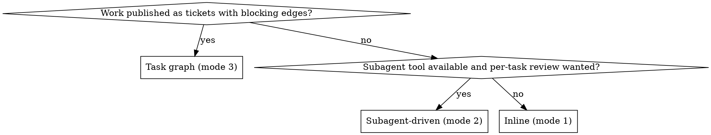

# Executing Plans

Turn an approved plan into committed, verified work. One skill, three modes: inline, subagent-driven, and task graph.

**Core principle:** The plan already did the thinking. Execute it exactly, prove each step with a test you watched fail and then pass, and leave a record that survives your own forgetting.

## Choosing a Mode



| Mode | Implements | Reviews | Cost |
|------|-----------|---------|------|
| 1 Inline | you, in this session | one fresh whole-branch review at the end | one context plus one reviewer |
| 2 Subagent-driven | a fresh implementer subagent per task | a fresh task reviewer per task, plus one whole-branch review | a fresh context per task and per review |
| 3 Task graph | an implementer subagent per ticket in its own worktree | a merger subagent per merge, then one whole-branch review | many concurrent contexts, coordination overhead |

Pick in this order:

1. **Tickets with blocking edges** — the work arrives as a ticket graph with dependencies between tickets. Use mode 3; see [references/task-graph.md](references/task-graph.md).
2. **No subagent tool, or the human chose inline** — use mode 1; see [references/inline.md](references/inline.md).
3. **Otherwise** — use mode 2 when the human wants a review gate on every task, or when the plan is long enough that later tasks would run on your compacted context. See [references/subagent.md](references/subagent.md).

All three modes share the setup, the ledger, the task loop, the stops, and the rulings below. Only the dispatch and review mechanics differ.

## Shared Setup

1. **Isolated workspace.** Use `using-git-worktrees` to create a worktree or verify the existing one. Never implement on a main/master branch without explicit consent.
2. **Workspace.** Run `bash scripts/sdd-workspace PLAN_FILE`. It prints the plan's git-ignored directory, `<repo-root>/.skills/sdd/<plan-basename>/`, home to every artifact for this plan: ledger, briefs, reports, review packages, test logs. Another plan's directory is never yours to read or write.
3. **Ledger.** It lives at `<workspace>/progress.md` and its first line is `# SDD ledger — plan: <plan file path>`. Harness todos are a live view; the ledger is the record. If a ledger already exists, read [references/resuming.md](references/resuming.md) before anything else.
4. **Plan and spec.** Read the plan once: its context, its Global Constraints, one todo per task. Read the spec it names. The spec is the binding authority; the plan is its argument. A plan with no reachable spec gets a ledger note saying so — rulings made without one are provisional.
5. **Preflight.** Run the interface-conflict scan in [references/preflight.md](references/preflight.md) before Task 1: one ledger row per pair of tasks that share a file or interface, and a ruling for every conflict the rows surface.
6. **Discipline.** Load `test-driven-development` now, before Task 1. It governs every step of every task; a plan whose steps already say "write the failing test first" does not exempt you.

## The Task Loop

Same loop in every mode. Mode 1 runs it yourself; mode 2 hand it to a fresh implementer; mode 3 runs it per ticket.

1. **Take the task.** Get its brief, record BASE (`git rev-parse HEAD`), and read the brief — every task, including ones you remember from setup. What you remember is a summary; the brief has the exact values, signatures, and test cases. Never make a subagent read the whole plan file.
2. **Work the steps in order.** The plan's steps are already in RED-GREEN order. A test step's code is written first and run first; watching it fail is a step, not a formality. Every step that runs a command has an `Expected:` line: run it, read the output, compare.
3. **Classify a mismatch.** The code is wrong → `systematic-debugging`, find the cause, never patch the symptom. The plan is wrong → rule on the smallest change that satisfies the spec, ledger it, continue.
4. **Commit as the plan's commit steps say**, with each message in the [conventional-commits](../conventional-commits/SKILL.md) format. A task that spans several commits is fine. BASE is what the review range is cut from, never `HEAD~1`.
5. **Satisfy the completion contract.** With evidence in this session, not inferred from the diff looking right:
   - every test the brief names exists and ran in this task, and you read the output;
   - the final test run for the task passed, and the ledger line carries the command and result;
   - every `Expected:` line was compared against real output;
   - every deviation from the brief has a `Ruling:` line in the ledger.
6. **Record the task.** Append the completion line, then take the next task. Never record a task whose tests failed; a failing run records nothing.

`verification-before-completion` governs the completion claim. If any item is missing, the task is not complete — finish it.

## Continuous Execution

Do not pause between tasks. Do not ask "should I continue?", do not post progress summaries. The human asked you to execute the plan; execute it. Exactly four things stop you:

1. An irreversible or destructive operation.
2. A security-sensitive action.
3. A side effect outside this worktree that norms say you ask about first — a merge, a push to a shared branch, a publish.
4. A plan so broken that every path forward is a guess.

For those, stop and ask. Everything else, decide and keep going.

## Rulings, Not Stalls

Conflicts, ambiguities, plan defects — decide them. The spec is binding, the plan is its argument, and your judgment settles what neither answers. Record every decision in the ledger as:

```
Ruling: <what you decided> — <why> — <what it costs if wrong>
```

A wrong ruling costs rework your human partner can see and undo; a session parked on a question costs their whole day and buys nothing. Deviating from the plan without a ledgered ruling is a decision made in secret. Carry a ruling forward: later tasks that touch the same interface read it from the ledger.

## Review

**Mode 1** buys one fresh whole-branch review at the end. **Mode 2** buys a task review (spec compliance and code quality) after every task, plus the whole-branch review. **Mode 3** buys a merger check per merge plus the whole-branch review. Implementer self-review never replaces a review seat.

Per-task review is a task-scoped gate: missing requirements, extra features, misunderstood requirements, then code quality and test honesty. Never skip it, and never accept a report missing either verdict. When the reviewer reports "cannot verify from diff", you resolve each item yourself — you hold the cross-task context it lacks — and treat a confirmed gap as a failed spec review.

Sort findings by effect before acting: a finding's grade is what a reasonable person using this software gets if it ships, not whether the spec names the trigger. Then:

- **Critical and Important** enter one fix pass.
- **Minor** goes to the ledger as `Task <N>: minor (deferred): <one-liner>` and to your final message. Minors never enter a fix pass and never become rulings.

A fix pass is one pass. Each fix is verified by TDD: write the test that reproduces the finding, watch it fail, make it pass, then run the whole suite. A fix without a test that failed first is not verified; a suite that is not green means the pass is not over. There is no second fix pass — a finding you decide not to fix is a ruling, and it reaches your human partner.

Fix dispatch rules, the round cap, and the breaker live in [references/fix-loop.md](references/fix-loop.md); read it before every round.

## Completion

1. `verification-before-completion` governs every claim in your final message.
2. Collect every ledger line containing `Ruling:` into "Rulings I made", in order, each with its cost if wrong. Collect every `minor (deferred)` line into "Deferred minors". Both lists are exhaustive: your final message is the only place the decisions you took on your human partner's behalf reach them.
3. Delete this plan's workspace once the final review is clean and its fixes are committed. The git history is the record now. Sibling directories belong to other plans; leave them alone.
4. Hand off to `finishing-a-development-branch`.

## Model Selection

Cheapest sufficient tier, specified explicitly on every dispatch. An omitted model silently inherits your session's model — often the most capable and most expensive — which defeats the whole section.

- **Transcription tasks** (the plan text contains the complete code to write): cheapest tier. Implementation is transcription plus testing.
- **Mechanical tasks** (1-2 files, complete spec): cheap tier.
- **Integration and judgment** (multi-file coordination, pattern matching, debugging): standard tier.
- **Architecture and design**, and the final whole-branch review: most capable available.
- **Reviews**: scale to the diff's size, complexity, and risk. Scoped re-reviews of small fix diffs take cheap-to-mid.
- **Fix-loop escalation**: at least one tier above the implementer that got stuck.

**Turn count beats token price.** Wall-clock and context cost scale with turns, and the cheapest models routinely take 2-3× the turns on multi-step work. Mid-tier is the floor for reviewers and for implementers working from prose.

## Common Rationalizations

| Excuse | Reality |
|--------|---------|
| "I remember what Task N says" | You remember a summary. The brief has the exact values. Read it. |
| "The plan's code is right, skip watching the test fail" | A test you never saw fail proves nothing. It is one step. Run it. |
| "I'll run the full suite at the end instead of per step" | Per-step runs tell you which step broke it. The end-of-task run is the contract, not a substitute. |
| "The plan is wrong here, I'll just do the right thing" | Do the right thing and ledger the ruling. Unledgered deviation is a decision made in secret. |
| "I'll write the ledger lines after a few tasks" | Compaction does not wait for a convenient moment. One line per task, in the same message as the commit. |
| "Let me check in before the next task" | They asked you to execute. Progress prompts spend their time instead. Only the four stops stop you. |
| "Tests should pass, the change was trivial" | "Should" is not evidence. The contract requires the command and its output. |
| "The reviewer said Minor, so it's Minor" | The label may have graded the spec's silence. Grade what the person using the software gets. |
| "The fix is obvious, no need for a failing test first" | The failing test is the only proof the finding was real and is now gone. Otherwise you have a diff and a hope. |
| "I'll fix the minors too while I'm in there" | Every minor you fix is a test, a fix, and a suite run nobody asked for. Ledger them; your human partner decides. |
| "One more round will converge" | Past the cap, rounds do not converge — the failure is structural. Adjudicate and route. |
| "The implementer spawned its own reviewer — free extra assurance" | A duplicate seat reviewing the same diff. The task review is the gate; a worker-spawned reviewer is a defect to flag. |
| "Ledger bookkeeping is overhead" | The ledger is what survives compaction. Controllers without one have re-dispatched entire completed task sequences. |

## Files

- [references/inline.md](references/inline.md) — mode 1 in full: ledger, task loop, completion contract, final review.
- [references/subagent.md](references/subagent.md) — mode 2 in full: dispatch contract, report handling, task review, fix loop, final review.
- [references/task-graph.md](references/task-graph.md) — mode 3 in full: integration branch, per-ticket worktrees, mergers, frontier, closing tickets.
- [references/preflight.md](references/preflight.md) — the interface-conflict scan.
- [references/resuming.md](references/resuming.md) — resuming from an existing ledger.
- [references/handling-reports.md](references/handling-reports.md) — reports that are not DONE.
- [references/cannot-verify.md](references/cannot-verify.md) — reviewer items that need your judgment.
- [references/batching.md](references/batching.md) — folding small same-shape tasks into one dispatch.
- [references/fix-loop.md](references/fix-loop.md) — rounds, cap, breaker.
- [references/final-review.md](references/final-review.md) — the whole-branch review and finish.
- [implementer-prompt.md](implementer-prompt.md), [task-reviewer-prompt.md](task-reviewer-prompt.md), [re-review-prompt.md](re-review-prompt.md) — dispatch templates.
- `scripts/sdd-workspace`, `scripts/task-brief`, `scripts/review-package`, `scripts/task-start`, `scripts/task-done` — the workspace, brief, package, and bookkeeping helpers.
