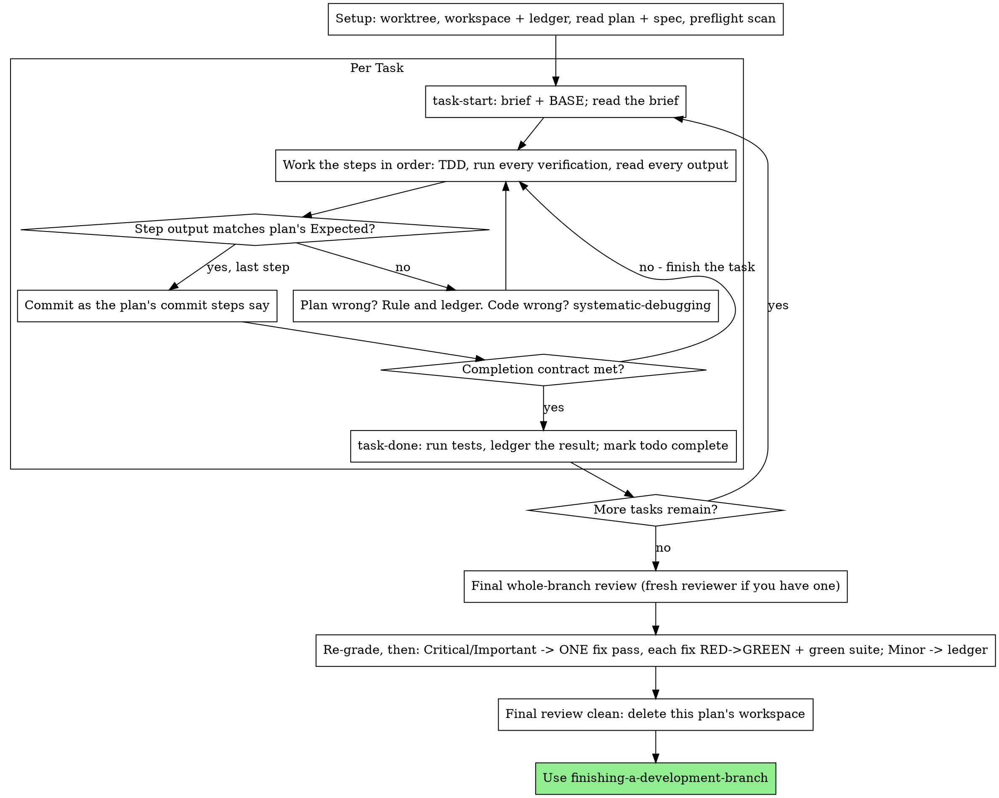

# Inline Execution

Mode 1. You implement every task yourself in this session. One fresh review of the whole branch at the end. No implementer subagent per task, no reviewer per task.

**What it buys and costs.** Subagent-driven development pays for a fresh implementer and a fresh reviewer on every task, each re-reading the codebase from zero. Inline pays for one context (yours) plus one reviewer at the end. What it gives up is a fresh context per task and a second pair of eyes per task. This mode keeps what those two things bought, by other means: the brief is the spec, the ledger is your memory, TDD is the per-task gate, and the final reviewer is the second pair of eyes.

**Narration:** between tool calls, narrate at most one short line — the ledger and the tool results carry the record.

A fully specified plan makes inline execution transcription plus testing: it runs well on a mid-tier session model. The one place the most capable model earns its cost is the final review, which you dispatch separately.



## Setup

Ensure the work happens in an isolated workspace: use `using-git-worktrees` to create one or verify the existing one. Never start implementation on a main/master branch without explicit consent.

Conversation memory does not survive compaction. An inline executor that loses its place re-implements tasks whose commits already exist — the same failure as a controller re-dispatching them, paid for in your own context. Track progress in the ledger file, not only in todos.

- Each plan owns a workspace: run `bash scripts/sdd-workspace PLAN_FILE` from this skill's directory. It prints the plan's git-ignored directory under `<repo-root>/.skills/sdd/`.
- Check `<workspace>/progress.md`. If it exists, read [resuming.md](resuming.md): tasks with a `Task <N>: complete` line are DONE; resume at the first task without one. Their commits exist in git even when your context no longer remembers making them: after compaction, trust the ledger and `git log` over your own recollection.
- Create the ledger with its identity as the first line: `# SDD ledger — plan: <plan file path>`.
- `git clean -fdx` destroys the workspace (it is git-ignored scratch); if that happens, recover from `git log`.

Read the plan once, note its context and Global Constraints, create a todo per task, and read the spec it names. Run the preflight scan in [preflight.md](preflight.md).

Load `test-driven-development` before Task 1.

## The Task Loop

Everything you print, and every tool result, stays resident in your context for the rest of the session. Redirect long test output to a file in the workspace and read its tail; read a brief, not the whole plan.

### 1. Take the task

Run `bash scripts/task-start PLAN_FILE N`. It prints the brief path and BASE (the commit the task's range is cut from) in one call. Read the brief. Mark the task's todo in_progress.

Every tool call is a turn that re-reads your whole context. Bookkeeping rides along with work — a ledger append in the same call as the commit, never in a call of its own.

### 2. Work the steps

Follow the plan's steps in their RED-GREEN order. Every step that runs a command has an `Expected:` line. Three outcomes:

- **Matches.** Next step.
- **The code is wrong.** Use `systematic-debugging`. Find the cause; never patch the symptom to make the output match.
- **The plan is wrong.** Rule on the smallest change that satisfies the spec and ledger it as `Task <N>: Ruling: <finding> — <what you decided and why>`.

Commit as the plan's commit steps say. BASE is what the review range is cut from, never `HEAD~1`.

### 3. The completion contract

Before a task's ledger line, all of the following are true, with evidence in this session:

- Every test the brief names exists and ran in this task, and you read the output.
- The final test run for the task passed — `task-done` is that run, and it writes the command and result into the ledger line.
- Every `Expected:` line in the brief was compared against real output.
- Every deviation from the brief has a `Ruling:` line in the ledger.

`verification-before-completion` governs the claim. If any item is missing, the task is not complete: finish it.

### 4. Complete the task

Run `bash scripts/task-done PLAN_FILE N BASE -- <test command>` with the test command the brief names for the whole task. It runs the tests, keeps the full output in the workspace, prints the tail, and — only if they pass — appends:

```
Task <N>: complete (commits <base7>..<head7>, tests: <command> → <result>)
```

A failing run records nothing. When it records, mark the todo complete and take the next task.

## Final Review

Generate the package with `bash scripts/review-package PLAN_FILE MERGE_BASE HEAD` (MERGE_BASE = the commit the branch started from, e.g. `git merge-base main HEAD`) and review from the file it prints.

**With a subagent tool:** dispatch the reviewer on the most capable available model — a whole-branch review is a judgment task — using the `code-review` skill's review method, pointed at the package path, the plan and spec paths, the plan's Review Focus section verbatim if it has one (the input classes and failure modes the plan's tests do not exercise), and the ledger's `Ruling:` lines so it can weigh the calls you made. Specify the model explicitly. This is the one fresh context the whole run buys: do not skip it, and do not replace it with your own read of the diff.

**Without a subagent tool:** perform that review yourself against the package, as a separate pass after the last task's ledger line. Write `Final review: self-review (no subagent tool)` to the ledger and say so in your final message: a self-review by the author is weaker than a fresh reviewer, and your human partner decides whether that is enough before merge.

### Re-grade, then gate

The reviewer's severity labels are advice; the gate is yours. Its "declined to judge" list is yours too: every line there is a ruling you make and ledger, exactly like a plan conflict.

Re-grade first, by effect: a finding's grade is what a reasonable person using this software gets if it ships, not whether the spec names the input that triggers it. A reviewer who set a finding at Minor because the spec was silent has graded the spec, not the effect.

- **Critical and Important** enter the fix pass.
- **Minor** goes to the ledger as `Final: minor (deferred): <one-liner>` and to your final message under "Deferred minors". Minors never enter the fix pass and never become rulings — a ruling is a decision about a conflict, not a note that you declined a polish suggestion.

### The one fix pass

Fix the Critical and Important findings yourself — you are the implementer here — in ONE pass. Each fix is verified by TDD, not by a second reviewer: write the test that reproduces the finding, watch it fail, make it pass, run the whole suite. Record each as `Final: fixed <finding> — <test name> RED→GREEN, suite <N>/<N>`.

A fix without a test that failed first is not verified; a suite that is not green after the pass means the pass is not over. Do not dispatch a re-review: it would re-read a diff whose covering tests already answer "addressed" and whose suite run already answers "broke nothing".

A finding you decide not to fix is a ruling — `Final: Ruling: <finding> — <why the code stands> — <cost if wrong>` — and reaches your human partner in the rulings list. There is no second fix pass.

## Finish

Before you delete anything, collect every ledger line containing `Ruling:` into your final message under "Rulings I made", in the order you made them, each with what it costs if wrong, and every `minor (deferred)` line under "Deferred minors". Both lists are exhaustive. Your final message is the only place the decisions you took on your human partner's behalf — and the findings you chose not to act on — reach them.

When the final review is clean and its fixes are committed, delete this plan's workspace directory — the git history is the record now. Sibling directories belong to other plans; leave them alone.

Use `finishing-a-development-branch`.
