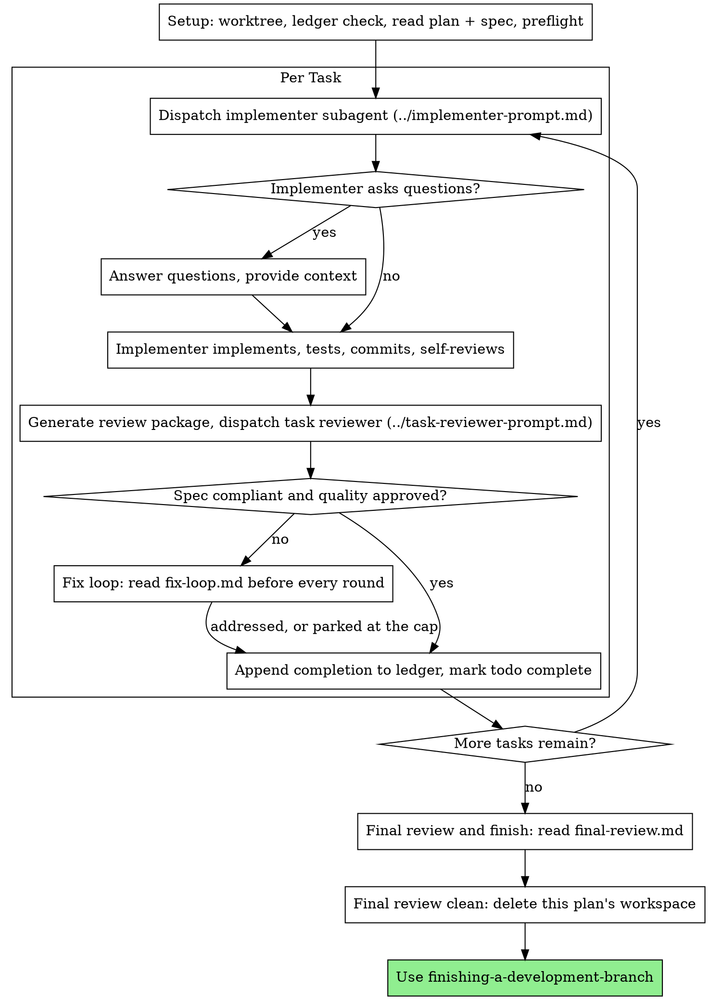

# Subagent-Driven Execution

Mode 2. A fresh implementer subagent per task, a task review (spec compliance and code quality) after each, and a broad whole-branch review at the end.

**Why subagents:** each implementer starts from exactly the context you construct, never from your session history, so it stays focused and your context stays free for coordination.

**Core principle:** fresh subagent per task, task review, broad final review. Fresh context plus a second pair of eyes on every task is what inline mode trades away.



## Setup

Use `using-git-worktrees`, create the workspace with `bash scripts/sdd-workspace PLAN_FILE`, check the ledger against [resuming.md](resuming.md), read the plan and spec, then run the preflight scan in [preflight.md](preflight.md) before dispatching Task 1.

Load `test-driven-development` so you can judge the implementer's TDD evidence.

## Dispatch Contract

Everything you paste into a dispatch prompt, and everything a subagent prints back, stays resident in your context and is re-read on every later turn. Hand artifacts over as files.

**Waiting on subagents:** never poll with short timeouts, and never sit in one silent open-ended wait. While you have local work — ledger updates, packaging the next review, reading reports — keep working; child results arrive on their own. When genuinely idle, wait in bounded stretches (five to ten minutes where the platform allows), post one line of status between stretches, and chase any child that finished without reporting.

### 1. Dispatch the implementer

Record BASE (`git rev-parse HEAD`) before dispatching — the review package and fix-round diffs need it.

Compose the dispatch so the brief stays the single source of requirements:

1. One line on where this task fits in the project.
2. The brief path, introduced as "read this first — it is your requirements, with the exact values to use verbatim". Produce it with `bash scripts/task-brief PLAN_FILE N`, which writes `<workspace>/task-<N>-brief.md` and prints the path.
3. Interfaces and decisions from earlier tasks that the brief cannot know, including a pointer to any ledger ruling in the area this task touches.
4. Your resolution of any ambiguity you noticed in the brief.
5. The report-file path (`<workspace>/task-<N>-report.md`) and the report contract.

Exact values — numbers, magic strings, signatures, test cases — appear only in the brief. Never make a subagent read the whole plan file, and never paste accumulated prior-task summaries: a fresh subagent needs its task, the interfaces it touches, and the global constraints. In one real session a dispatch reached 42k characters, of which 99% was pasted history.

The dispatch carries the no-subagents contract from the template: the implementer never dispatches subagents — not helpers, and never a reviewer. Review arrives from you, after the report. A worker-spawned reviewer duplicates the task review at full cost.

Record the implementer's agent identity from the dispatch result; fix-loop rounds 1-3 resume this agent. Never dispatch multiple implementation subagents in parallel in this mode — they conflict.

Template: [../implementer-prompt.md](../implementer-prompt.md). Choose the model per SKILL.md's Model Selection and always state it.

### 2. Handle the report

**DONE:** generate the review package with `bash scripts/review-package PLAN_FILE BASE HEAD` and dispatch the task reviewer with the printed path. BASE is the commit you recorded before dispatching — never `HEAD~1`, which silently drops all but the last commit of a multi-commit task.

**DONE_WITH_CONCERNS, NEEDS_CONTEXT, BLOCKED:** read [handling-reports.md](handling-reports.md) and follow it, every time.

If the implementer asks questions, before starting or mid-task, answer clearly and completely and give it the context it needs. Do not rush it into implementation.

### 3. Review the task

Per-task review is a task-scoped gate; the broad review happens once, at the end. Never skip it, and never accept a report missing either verdict — spec compliance and task quality are both required. Implementer self-review never replaces it.

- **Hand over the diff as a file.** Run `bash scripts/review-package PLAN_FILE BASE HEAD` and pass the printed path. The package never enters your context, and the reviewer sees commits, stat, and full diff with context in one read. Never dispatch a task reviewer without a diff file.
- **Three paths plus constraints.** The reviewer gets the brief, the report, and the package, plus the global constraints that bind the task. That constraints block is its attention lens: copy binding requirements verbatim from the plan's Global Constraints or the spec — exact values, formats, stated relationships ("same layout as X").
- **Do not add open-ended directives** like "check all uses" without a concrete, task-specific reason.
- **Do not ask for tests the implementer already ran** on the same code; the report carries that evidence.
- **Do not pre-judge.** Never instruct a reviewer to ignore or not flag an issue, and never label something "at most Minor". If you believe a finding is a false positive, let it be raised and adjudicate in the fix loop. If your prompt contains "do not flag", "don't treat X as a defect", or "the plan chose", stop — you are pre-judging, usually to spare yourself a loop.

Template: [../task-reviewer-prompt.md](../task-reviewer-prompt.md). "Cannot verify from diff" items: read [cannot-verify.md](cannot-verify.md) before marking the task complete.

### 4. The fix loop

It triggers on spec ❌, any Critical or Important finding, or a confirmed ⚠️ gap. Read [fix-loop.md](fix-loop.md) before every round: it holds the round cap, the breaker, and the ledger line each round writes, and your memory of it does not survive compaction.

### 5. Complete the task

When the review is clean — or every open finding is parked with a ruling at the cap — append the completion line in the same message as your other bookkeeping:

```
Task <N>: complete (commits <base7>..<head7>, review clean)
Task <N>: complete (commits <base7>..<head7>, <K> parked)   # after a tripped breaker
```

Then mark the todo complete and move on. Never advance while the review has open Critical or Important issues that are neither fixed nor parked with a ruling.

## Final Review

When every task is complete, read [final-review.md](final-review.md) and follow it: the whole-branch review, its single fix wave, and how you finish.
