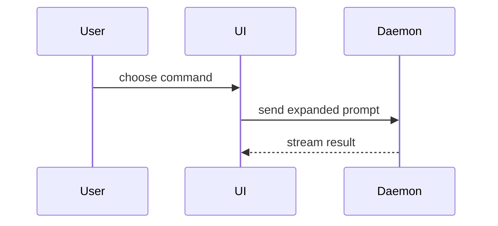

# Writing the PR body

Use this template. Skip preambles, keep prose brief, and use the project's own vocabulary (from `GLOSSARY.md` when one exists).

```markdown
## Summary

<diagram, diff sketch, or tree>

## Evidence

- **Before:** <screenshot / output / failing test run>
  **After:** <screenshot / output / passing test run>

## Merge Danger

**Door:** <one-way or two-way>

<optional: description>

**Blast Radius:** <one-word description>

<optional: possible ramifications of merging>
```

## Summary

Pick the smallest view that makes the key point clear. Place the visual next to the short text it supports, and keep only the calls, files, props, states, and boundaries needed to answer the reader's question.

Show logic or an algorithm as pseudocode:

```text
on(save)
  if content is unchanged
    return cached result
  write new content
  return fresh result
```

Show runtime control flow as a call tree:

```text
submitForm
  createSession
    persistPrompt
    launchAgent
  navigateToSession
```

Show UI structure as a component tree, including the state and module boundaries that matter:

```text
<SessionPage> (apps/example/src/routes/session.tsx)
  useSessionEvents()
  <SessionToolbar>
    <RunSkillButton> (packages/ui)
```

Show file responsibility, or a broad refactor, as a shallow file tree:

```text
src/
├── commands/       # parses user actions
├── sessions/       # owns session state
└── transport/      # sends API requests
```

Show component interaction, control flow, or data flow with Mermaid:



Use a diff when the point is what changed and the surrounding shape already exists. Match the diff shape to the topic.

Component change:

```diff
 <SessionPage>
   useSessionEvents()
   <SessionToolbar>
+    <RunSkillButton />
   <SessionTimeline>
+    <SkillResultCard />
```

File layout change:

```diff
 src/
 ├── commands/
+│   └── show-me.ts       # expands the slash command
 ├── sessions/
-└── transport.ts
+└── transport/
+    ├── client.ts
+    └── stream.ts
```

Call-tree change:

```diff
 submitForm
   createSession
     persistPrompt
+    expandSkillMention
     launchAgent
-  navigateToSession
+  navigateToSession
+    subscribeToEvents
```

State or control-flow change:

```diff
 on(save)
-  write content
+  if content is unchanged
+    return cached result
+  write new content
+  invalidate cache
```

Show the whole block when most of it is new, when omitted context would hide ownership or order, or when the reader needs a copyable target shape:

```ts
function expandSkill(command: string): string {
  const skillName = command.slice(1);
  return `use the ${skillName} skill`;
}
```

You may use one of these; you may use several. It is unlikely you will use all of them. Use judgement and do not overwhelm the reader.

## Evidence

Concrete proof the change works, shown as a before and after.

Screenshots are the strongest evidence when the environment is set up for them and the change is visual. Execution-based evidence comes next: test results and console output, showing the exact test that failed before and passes now.

State the commands you ran and their result. "Tests pass" without output is a claim, not evidence.

## Merge Danger

**Door:** a two-way door can be walked back; a one-way door cannot. A PR that is cheap to roll back is lower risk. Destructive actions and hard-to-reverse decisions — schema drops, data migrations, public API changes, deleted branches — are one-way doors.

**Blast radius:** the potential impact or scope of the change. Consider every consumer: layout shift, breakages for downstream users, mobile responsiveness, cache invalidation, background jobs, alerting. One word, then the ramifications if they are not obvious.

## Attribution

The Summary section's menu of visuals (pseudocode, call trees, component trees, file trees, Mermaid, diffs) and its placement guidance come from [Dex Horthy](https://github.com/dexhorthy)'s [`show-me`](https://github.com/humanlayer/humanlayer) skill at Humanlayer, reproduced almost word for word and aimed at a diff instead of a live conversation.
