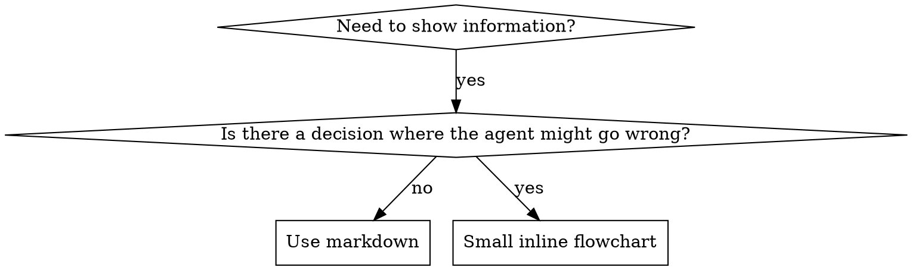

# Flowcharts in skills

Part of [`writing-for-agents`](../SKILL.md). Use a flowchart only where a decision is genuinely non-obvious; everything else is prose.



## When a flowchart earns its place

- A non-obvious decision point, where the wrong branch is a real failure.
- A process loop where the agent might stop too early or loop forever.
- "When to use A versus B" where both look plausible at the start.

## When it does not

- **Reference material** → a table or a list.
- **Code or commands** → a fenced code block; a diagram cannot be copied.
- **Linear instructions** → a numbered list.
- **Labels without meaning** (`step1`, `helper2`) → name the action or the state.

A flowchart that restates three numbered steps adds a second source of truth and a maintenance cost. If the decision fits in one sentence, write the sentence.

## Conventions

Follow [graphviz-conventions.dot](graphviz-conventions.dot): diamonds for decisions, boxes for actions, plaintext for literal commands, ellipses for states, octagons for stop warnings, double circles for entry and exit points. Edge labels are `yes`/`no` or the observable condition.

Keep a diagram small enough to read without zooming. If it needs a legend, it needs to be two diagrams or none.

## Rendering

[../scripts/render-graphs.js](../scripts/render-graphs.js) extracts every ` ```dot ` block from a skill's `SKILL.md` and renders it to SVG in `<skill-dir>/diagrams/`. It requires graphviz (`dot`) on the path.

From the collection root:

```bash
# One SVG per diagram
node skills/writing-for-agents/scripts/render-graphs.js skills/my-skill

# All diagrams in one image, for review
node skills/writing-for-agents/scripts/render-graphs.js skills/my-skill --combine
```

Invoke it through `node`, not as a bare `scripts/render-graphs.js` path: some packagers strip executable bits. Commit the `.dot` source inside `SKILL.md` — the SVG is a render, and the source is what stays editable.

Rendering is for the human reviewer. The agent reads the `dot` source, so labels must carry their meaning in text.
